<div align="center">

<picture>
  <source media="(prefers-color-scheme: dark)" srcset="assets/media/images/repo/header-dark.png">
  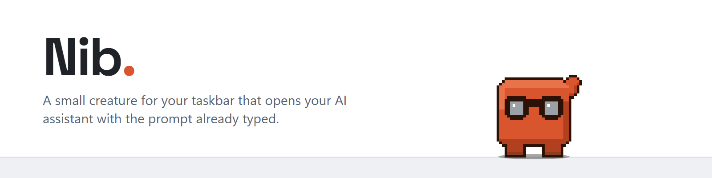
</picture>

[](https://github.com/IbramDawwaGmbH/the-nib/actions/workflows/checks.yml)
[](https://github.com/IbramDawwaGmbH/the-nib/releases/latest)
[](LICENSE)
[](docs/GETTING-STARTED.md)
[](requirements.txt)
[](https://doc.qt.io/qtforpython-6/)
[](https://github.com/IbramDawwaGmbH/the-nib/commits/main)

He walks up and down the bar, blinks, plays football, does press-ups, watches your cursor, waves,
sulks when you pester him, and naps it off. Click him — or press **Ctrl+Alt+C**, or drop a file on
him — and Claude, ChatGPT or Gemini opens with your prompt in the composer.


**[▶ Watch the one-minute film](assets/media/video/nib-film-v3.mp4)** · [15-second cut](assets/media/video/nib-15s-v3.mp4)

<sub>The film is staged from his real sprite frames and timings — not a screen recording.</sub>

**[Getting started](docs/GETTING-STARTED.md) · [Behaviours](docs/BEHAVIOUR.md) · [Settings](docs/SETTINGS.md) · [Contributing](CONTRIBUTING.md)**

</div>

---

**[⬇ Download Nib for Windows](https://github.com/IbramDawwaGmbH/the-nib/releases/latest)** — extract
the zip and run `Nib.exe`, no Python needed. Or run him from source:

```bash
pip install -r requirements.txt
pythonw main.py
```

Never used Python? → **[Getting started](docs/GETTING-STARTED.md)** walks through it from scratch.

---

## What he's for

| | |
| --- | --- |
| **Click him** | A prompt box opens above the taskbar |
| **Ctrl+Alt+C** anywhere | The same box, at your pointer — no hunting for him |
| **Ctrl+Alt+P** anywhere | Puts the clipboard up on a sign he holds — grab more to add to it, click him to use it |
| **Ctrl+Alt+G** anywhere | Fogs every screen while you step away — [the screen guard](#the-screen-guard) |
| **↑** in the box | Walks back through your recent prompts |
| **Type a sum or conversion** | Answered inline with a toast — never sent to the assistant |
| **Double-click him** | Sends your last prompt again |
| **Drop a file on him** | Opens your assistant asking about that file — no typing at all |
| **Shift+drop an image on him** | Reads the text out of it locally and opens the bubble prefilled with it |
| **Right-click him** | His tools fan out in a game-style wheel — flick toward one and let go, scroll for more |
| **Rest your pointer on him** | He leans into it |
| **Throw him** | He flies, bounces off the ends, and rolls to a stop |

The prompt is **prefilled, not sent** — you review it and press send yourself.

| Click him and ask | Drop a file on him |
| --- | --- |
| 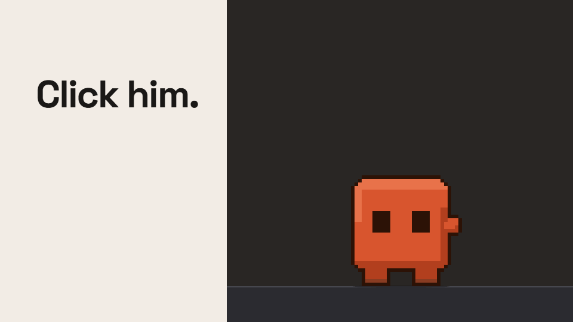 | 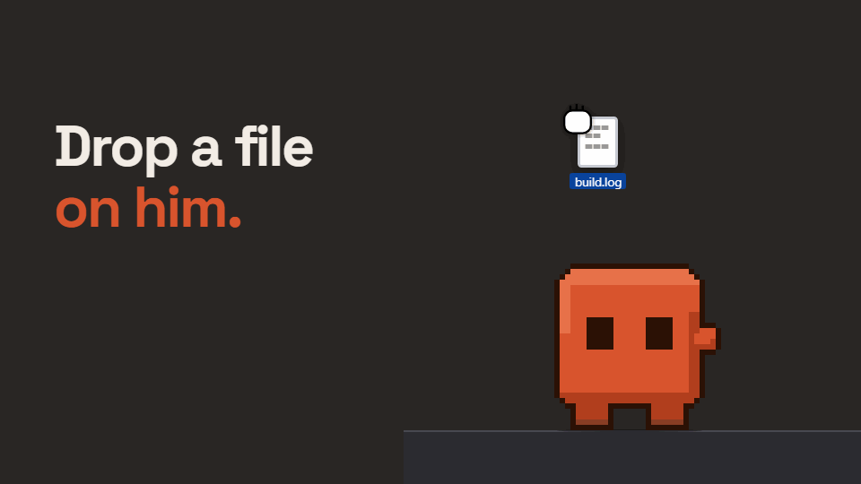 |
| **Right-click for his tool wheel** | **Rest your pointer on him** |
| 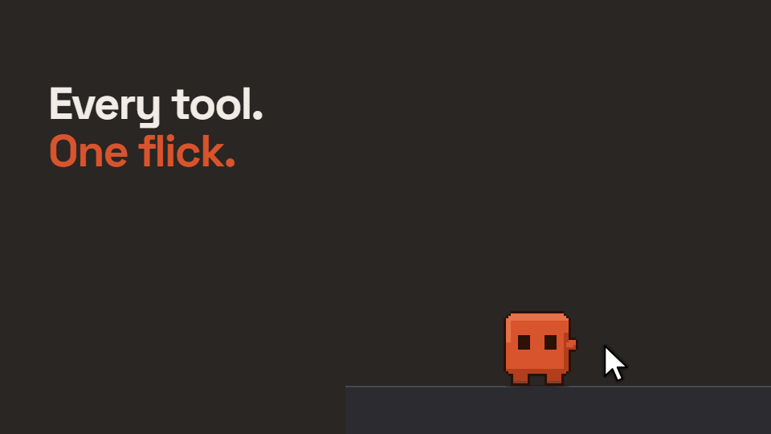 | 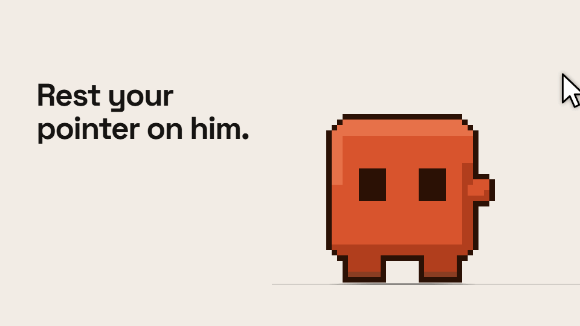 |

## Which assistant

Set `provider` in the settings window. He works with:

| | How it opens | Modes |
| --- | --- | --- |
| **Claude** | The Claude desktop app, via the documented `claude://` link | Chat, Cowork |
| **ChatGPT** | `chatgpt.com` in your browser, composer prefilled. No app needed | Chat |
| **Gemini** | `gemini.google.com` in your browser | Chat |

Adding another is [one entry in a table](docs/PROVIDERS.md) — the launcher is provider-agnostic and
everything else goes through it.

> He's Claude-orange by default, which is where this project started. If you're pointing him
> somewhere else, **Colour** in the tray has four other palettes.

## See him in action

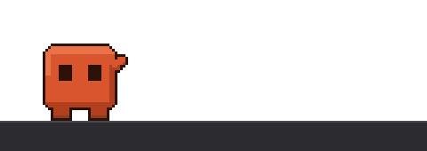

| Football | Press-ups | Dance | Hop |
| --- | --- | --- | --- |
| 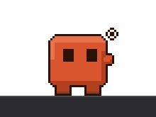 | 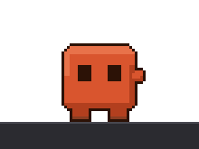 | 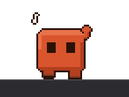 | 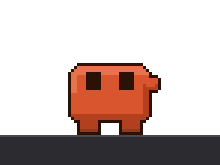 |

Every one of these has a measured firing rate, so none of them turns up more often than intended —
see [Behaviours](docs/BEHAVIOUR.md) for the full list and numbers.

And in his 53 costumes:

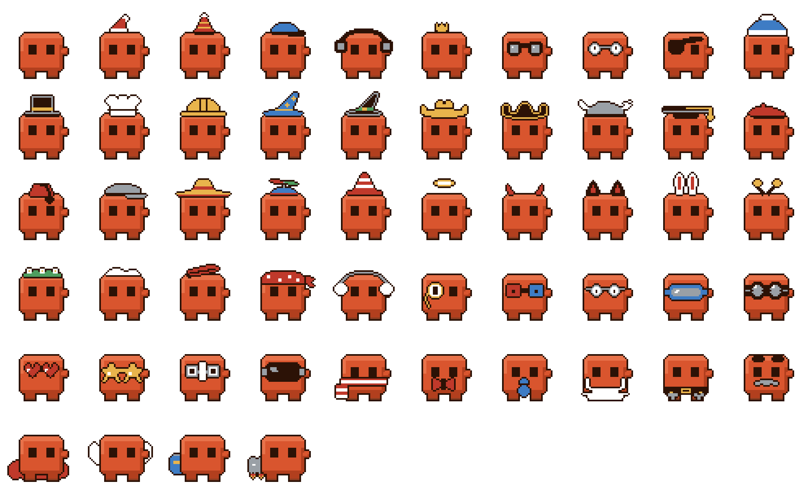

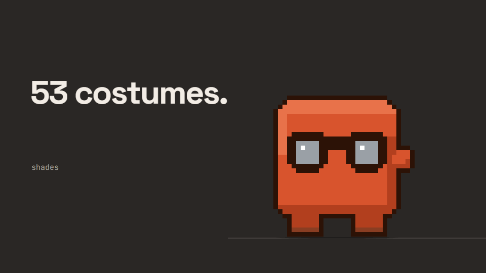

## What makes him different

He is not a static image with a click handler.

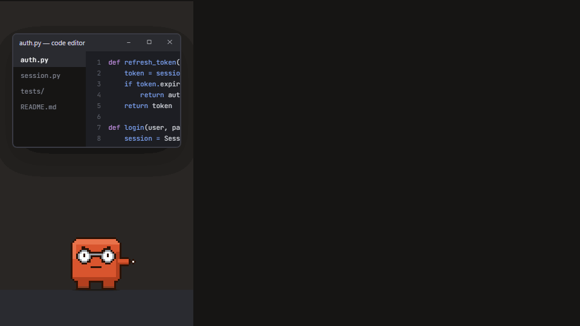

- **His feet don't slide.** Distance travelled is derived from the animation's own progress, so one
  walk frame always covers exactly one stride — at any tick rate, any speed, any mood. Verified to
  nine decimal places.
- **Clicks pass through his empty pixels.** A per-pixel mask taken from the sprite's alpha, so the
  rest of your taskbar stays clickable.
- **He knows what time it is.** Yawns in the morning, winds down at night, dances at knocking-off
  time, shivers in winter, fans himself when your machine is pinned, and puts a beanie on for the
  season.
- **He remembers how the day went.** Pet him and he's visibly bouncier for hours — and it survives
  a restart, fading on a half-life. Hover over the tray icon and it says how he is, by name.
  He keeps count of the days you've shared, too — counts only, readable and wipeable in
  **Settings → About him**.
- **He never moves your windows.** Not nudged, not resized, never brought to the front. There is
  exactly one deliberate exception — see [Drop him on a window](#drop-him-on-a-window) — and it is
  narrow enough to name in one sentence: dropping him on a window pins *that* window on top,
  position and size untouched, and nothing else in this app ever does anything like it. A test
  greps the source for every Win32 call that could and fails if one shows up anywhere it isn't
  supposed to.
- **He reads no window titles, no keystrokes, and no files** — with one named exception, the same
  way the window-pin above is the one exception to never moving your windows: Shift-drop an image
  on him and he reads the text out of *that* image, and only that image, locally. See
  [Privacy](docs/PRIVACY.md) and [Drop-to-OCR](#drop-to-ocr) below.
- **He makes no network requests of his own** — with one named exception, the same way: pick
  **Update and restart** on his wheel and he fetches his own update from GitHub (plus, from a git
  checkout, any packages it newly needs from PyPI, through pip), then and only then. Nothing checks
  for updates by itself. See [Update and restart](#update-and-restart) below.

## He notices when a job finishes

He already reacts to your machine being under load — this is what happens when that load *ends*.
Run a real build, render, export or install, and once it's been genuinely busy for a good stretch
and then drops back to quiet, he celebrates: a wind-up, a punch in the air, a twinkling sparkly hold,
and a settle into a satisfied smirk.

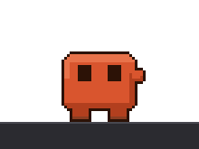

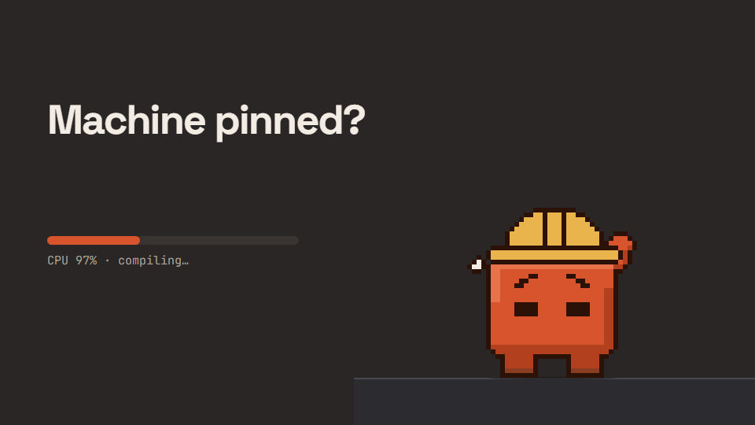

It's a pattern read off the same aggregate CPU counter the "machine's pinned" reaction already uses
— no process names, no window titles. A brief dip mid-build doesn't fool it and neither does a
five-second spike; it only fires once load has stayed high for a real stretch and then genuinely
gone quiet. Turn it off with `task_finished_reaction_enabled`. With sound on, it's also the one
deliberately cheerful noise in a set that otherwise keeps quiet on purpose.

## The snippet billboard

**Ctrl+Alt+P** grabs whatever's on your clipboard and puts it up on a sign he stands and holds —
readable on your taskbar for as long as you want it there. Grab again later and it doesn't replace
what's up there, it adds another line, so you can build up a short list as you go.

| | |
| --- | --- |
| 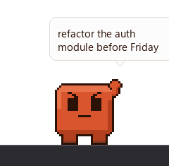 | 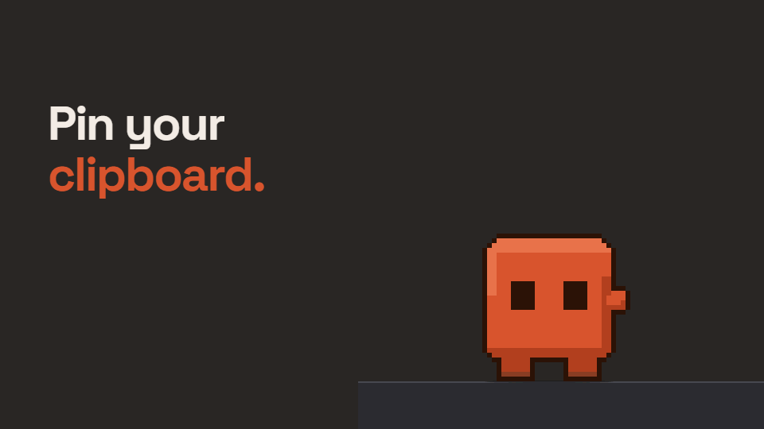 |

He braces to hold it — legs planted, teeth gritted, the same animation as bracing under a window —
rather than idling beside it, and stays that way, standing still, for as long as it's up. Click him
(or Ctrl+Alt+C) and the bubble opens with everything on the sign already in it; the sign comes down
and he goes back to wandering. Nothing here touches the disk — quitting takes the sign down, the
same as closing an app tab.

## Focus sessions

**Start focus** in the tray menu holds him at his post for a set length (25 minutes by default):
headphones on regardless of whatever costume you'd picked, typing away with the occasional
press-up break so a long session doesn't read as one frame left running. A small floating
countdown appears above him, its bar turning red in the last minute. Going idle pauses the clock;
getting him properly cross or calling him over cancels it outright rather than pretending it's
still running. Finishing on its own earns its own completion chime and the same celebration as
[a finished job](#he-notices-when-a-job-finishes) above. See
[Using him](docs/USING-HIM.md#the-focus-timer) for the details.

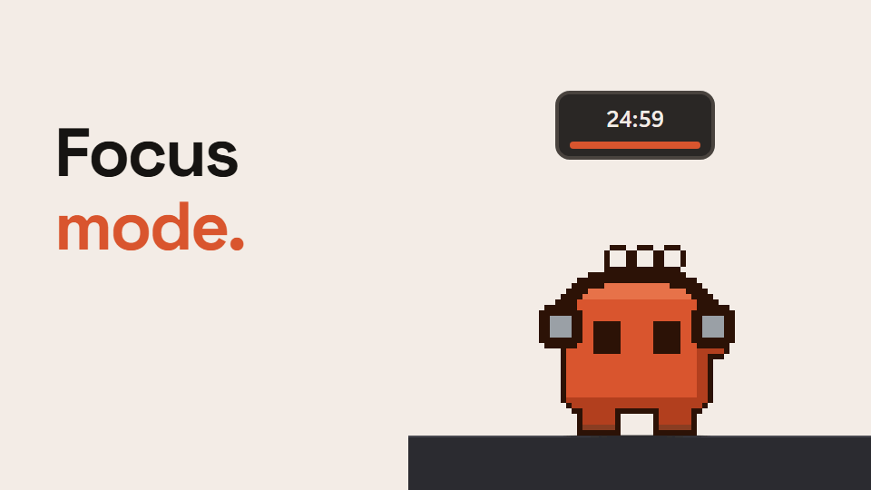

## The inline calculator

Type an arithmetic expression — `12 * 7`, `(1+2)*3`, `sqrt(16)`, `2 * pi` — or a unit conversion —
`3 miles in km`, `98.6 f to c`, `10 kg to lb`, `200 ml flour to grams` — into the same bubble that
opens everything else, and he works it out himself instead of sending it anywhere.

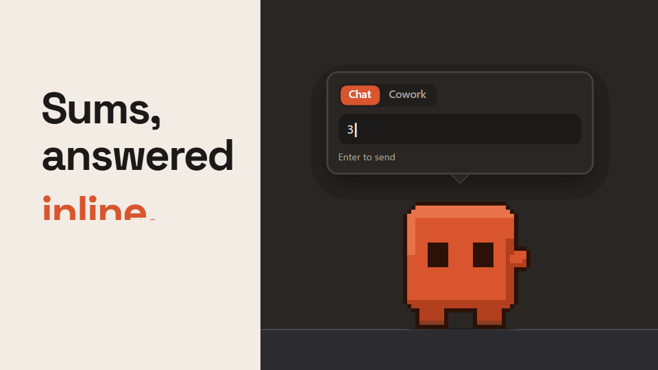

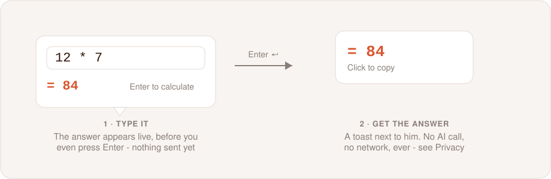

**Nothing is sent while you type.** The moment what's in the box is a recognised calculation, a
small answer line appears underneath it in his accent colour — `= 84` — and the hint swaps from
"Enter to send" to "Enter to calculate": a live preview, purely visual, gone the moment you keep
typing something that isn't one. Press Enter on it and the bubble closes exactly like a normal
send, but nothing launches — no `claude://`, no browser, no request of any kind. Instead a toast
appears next to him showing the answer; click it and just the number is copied to the clipboard.
He also plays a short "counting" animation, the same one that already plays when Calculator itself
has focus (see [App personas](docs/BEHAVIOUR.md#app-personas)) — reused as-is, so the feature cost
no new art. The billboard sign already has a job of its own, holding what your clipboard has
collected until you're ready to ask about it, so the answer gets a toast instead of borrowing it.

**A recognised calculation that's wrong is still answered, not sent.** `12 / 0`, `sqrt(-1)`,
`3 miles in kg` — mismatched dimensions and the rest — come back with a plain-English explanation
inline ("Can't divide by zero", "Can't convert length to weight") rather than being posted to your
assistant as a question. There's no counting animation for these, since that's earned only by a
clean answer, and no copy chip, since there's nothing worth copying. Anything that only resembles a
calculation — "why is the sky blue", "10 minutes in advance", "call John in 5 min", a bare "42" on
its own — is left completely alone and goes to the assistant exactly as before. The conversion
grammar only fires when **both** sides name a real, known unit; one recognised unit next to an
ordinary word reads as a sentence, not a mistake.

**Currency is deliberately left out.** "3 dollars in euros" goes to the assistant exactly as before,
untouched. Every other conversion here is a fixed, physical-constant ratio — true forever, safe to
bundle directly into the code — while an exchange rate isn't: it's either a live lookup, and Nib
makes no network requests of its own (the one exception is fetching his own update, when you ask),
or a bundled table that goes stale the day you install it.
Currency may get its own, clearly opt-in feature later. It isn't "coming soon" — it's an open
question.

Parsing never touches Python's `eval()`. A strict whitelist covers `+ - * / // % **`, `^` as an
alias for `**` (never the bitwise XOR it is in Python), parentheses, unary minus, and thousands
separators like `1,000`, plus a small function set — `sqrt`, `abs`, `round`, `min`, `max`, `floor`,
`ceil`, `sin`, `cos`, `tan`, `log`, `log10`, `log2`, `exp`, and the constants `pi` and `e`. Guards
bound both the size of the exponent and the bit length of the result, so something like
`((2**500)**500)**500` is refused — "that number's too big for me" — in well under a millisecond
rather than hanging or exhausting memory, checked with an adversarial-input test rather than just
asserted.

**Unit conversion spans twelve dimensions**, with every ratio bundled directly in the code: length,
mass, volume, time (down to milliseconds, up to a calendar year), speed, digital storage, area,
pressure, energy, power, angle, and temperature. Digital storage keeps decimal and binary
genuinely separate rather than picking one and hoping — `kb`/`mb`/`gb`/`tb` are the 1000-based
figures your OS shows for a download, `kib`/`mib`/`gib`/`tib` are the 1024-based ones a filesystem
actually uses — so `1 gb to gib` answers a real, different number instead of quietly guessing which
one you meant. Temperature is handled as an affine conversion rather than a simple ratio, since
Celsius, Fahrenheit and Kelvin don't share a zero point.

**Volume and mass convert too, but only by name.** `12 ml` and `12 g` aren't the same thing unless
you say what's in the cup — a millilitre of honey weighs about 40% more than a millilitre of
water — so `200 ml flour to grams` or `1 cup sugar in g` works (a small kitchen density table:
water, milk, honey, oils, flour, sugar, brown sugar, powdered sugar, butter, cocoa powder, rice,
salt — sourced against published baking-conversion references, not estimated), while a bare
`200 ml to grams` with no ingredient named stays quiet and goes to the assistant instead. Guessing
water for anything else would be confidently wrong exactly one time in several, which is the same
reasoning that keeps currency out below.

A calculation is never treated as a prompt: it doesn't enter your prompt history, doesn't touch
`last_prompt`, doesn't nudge his mood, doesn't clear a poke streak, and closing the bubble right
after one isn't counted as a poke — though it does still reset the being-ignored attention clock,
the same "noticed" every real interaction goes through, so a calculator-heavy stretch never reads
as ignoring him. Nothing about a calculation is ever logged, at any level. `calculator_enabled`
turns the whole thing off — a sum typed with it disabled is just sent as text, the same as before
this feature existed.

## The pixel ruler

Pick **Measure** from his tool wheel — or the tray icon's menu. Drag anywhere on either monitor and a
line follows your cursor with a live readout in pixels, inches and centimetres; release to lock
it in place.

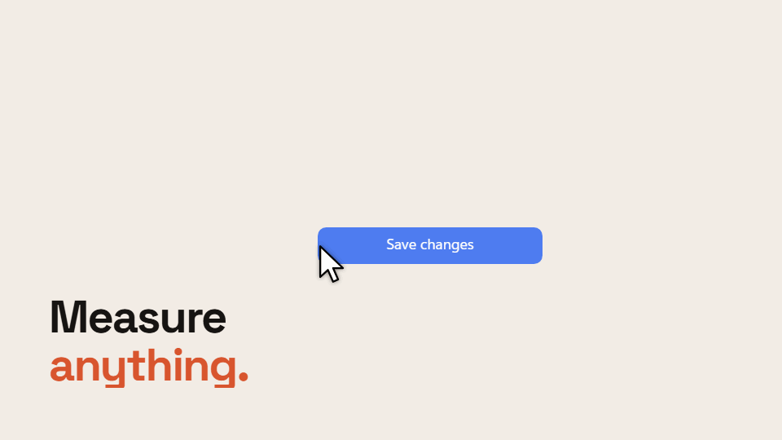

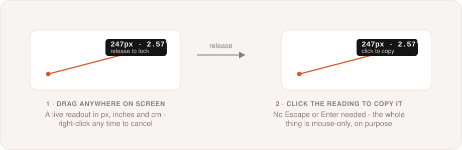

**It's entirely mouse-driven, on purpose.** The overlay carries `Qt.WindowDoesNotAcceptFocus`, so
it can never steal keyboard focus - or, in practice, foreground activation - from whatever you're
measuring: a dropdown or tooltip you opened to check its size stays open underneath it. The
tradeoff is that a window which never takes focus never receives key events either, so Escape and
Enter aren't the accept/cancel gesture here - the whole interaction is mouse-only instead. Drag to
measure, release to freeze the reading, **click anywhere to copy it and close** - a plain click,
not a click specifically on the reading itself - and **right-click at any point**, mid-drag or
already frozen, **to close without copying**. Starting a fresh *drag* from a frozen reading
measures again rather than accepting it, so several distances in a row don't need the menu
reopened each time - but a plain click anywhere else still accepts the one you already have,
rather than starting over wherever you clicked.

**The overlay is scoped to whichever monitor the cursor was on when you opened it**, not
stretched across all of them - a second monitor can run at a different DPI, and a ruler spanning
both would have to either lie about one of them or pick a scale that's wrong for half the screen.
Pixels convert to inches using that monitor's actual reported DPI, not an assumed 96, so the
reading is only as accurate as Windows' own DPI figure for that display.

**No dimming.** A screenshot tool darkens the screen to draw your eye to the selection; a ruler
does the opposite job - you're trying to measure something you can already see clearly, so
dimming it would work against the one thing this tool is for.

## Drop-to-OCR

Hold **Shift** and drop a screenshot or a photo of text on him. He reads the text out of it -
locally, using Windows' own on-device OCR engine - and opens the bubble prefilled with what he
found, exactly the way dropping plain text on him already works.

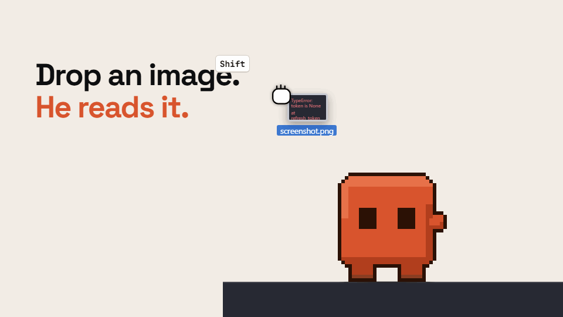

**The modifier key exists because dropping a file already does something.** An ordinary drop opens
your assistant to discuss the file, and that shouldn't silently change just because the file
happens to be an image - so OCR is something you explicitly ask for, not something that quietly
takes over. Drop an image without Shift and nothing about this feature is involved at all.

**Nothing is sent anywhere to read it.** `Windows.Media.Ocr` runs entirely on the device, the same
kind of local-only guarantee the calculator and the ruler both make, and for the same reason it's
worth stating plainly: it's a real architectural fact this app depends on, not a resource freebie.
The one honest caveat is that this API is officially documented as supported only for apps with a
package identity (an MSIX-style install), and Nib ships as a plain executable - it works today, in
every test run against it, but Microsoft doesn't guarantee it forever. That's why a copy of
[Tesseract](https://github.com/tesseract-ocr/tesseract) (Apache-2.0) ships inside Nib itself and
takes over automatically if the Windows engine is ever unavailable or fails - still fully local, no
separate install or download either way. Only if both somehow fail does he say a plain "couldn't
read that image" instead.

**A recognised image plays "look_around"** - his considering-something animation, already used
elsewhere for *why*/*how*/*explain*-shaped prompts - rather than any new art, the same free reuse
the calculator's "counting" animation and the ruler both lean on. An image with no readable text,
or OCR being unavailable on your machine, gets a plain message and no animation: nothing to
celebrate, but he still noticed you were here.

Nothing about a read - the image, the extracted text - is ever logged, at any level, matching the
rule every other local-processing feature here follows. The text only reaches your assistant if you
press Enter on the prefilled bubble yourself, same as any other prompt.

## He shows when your mic or camera is live

A dot on his tray icon while something is listening or watching, and a different colour for the
state that actually catches people out: **the microphone is live, and muted.** Talk into it for a
couple of seconds and he waves — wearing earmuffs — and puts up a **You're muted** toast you can
click to unmute. Then he says nothing for a minute, because a mascot that mentions it every few
seconds through a meeting you muted on purpose is one you turn off.

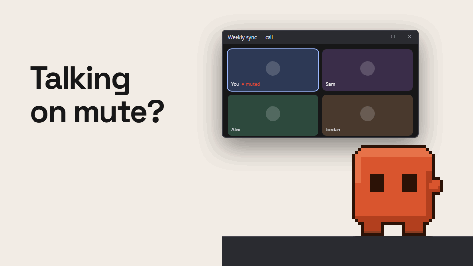

**Mute and unmute from the tray**, or bind `mic_toggle_hotkey` to do it from anywhere — empty by
default so it can't collide with the shortcut your call app already uses.

Two facts, from two different places, because Windows keeps them apart: whether the default mic is
muted comes from the audio endpoint, and whether anything is *using* the mic or camera comes from
the same consent store the Windows privacy indicator reads. **Neither is a recording of anything** —
no audio, no video, and not even which app, which is read only to answer "any of them?" and then
discarded.

**The camera is an indicator only, and that's a limit rather than a choice.** Windows exposes no
global camera mute: per-app consent does nothing to an app already running, and disabling the
device needs admin rights and breaks it for everything else. So there's no camera toggle here, and
a test asserts the code offers no way to pretend otherwise.

Set `mic_indicator_enabled` or `camera_indicator_enabled` to `false` to switch either off; with
both off, nothing is read at all.

## Drop him on a window

| | |
| --- | --- |
| 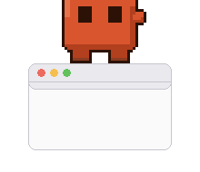 | 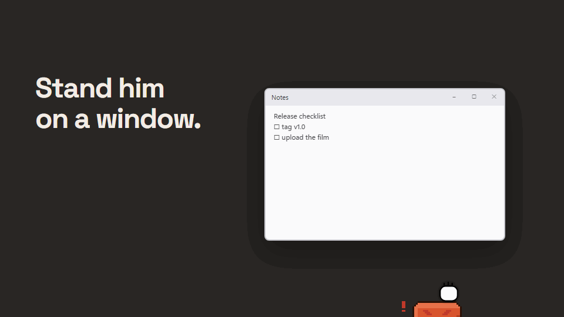 |

Set him down gently onto any real window instead of the taskbar, and he stands on it — top edge,
feet planted — and rides along as you move or resize it, keeping his place proportionally rather
than snapping back to centre. A real flick still flies through the window like anywhere else, judged
by the same release speed that already decides a throw, so tossing him across the screen never
surprises you by grabbing whatever's underneath. Grab him again to bring him down; that's the only
way off, on purpose, since the gesture that puts him somewhere should be the one that takes him
back.

Landing on it isn't the same moment as pinning it. He has to stand there undisturbed for a few
seconds before the window actually goes on top of everything else, so a drop that only happens to
land on a window in passing doesn't trigger it. Once it does pin, the **tray icon picks up a small
marker** and its tooltip says so — a pinned window can end up fullscreen and cover him completely,
so the tray is the one place left that still shows it.

**This is the one deliberate exception to "he never touches your windows."** Finding the window
under the drop point, and following it afterward, are both still read-only — the same trick the
overhead-window gag already uses. Pinning it is a single, narrowly-scoped `SetWindowPos` call, on
the one window you explicitly perched him on, that never moves it, resizes it, or steals its focus
— and it comes straight back off the moment the perch ends, however it ends. It is checked, not
just promised: a test verifies that call is the *only* place anything like it appears anywhere in
the codebase outside this one function.

Worth knowing before you rely on it: if Nib is force-killed rather than quit normally, the pin does
not get a chance to come off. Quitting normally, or ending the perch yourself, always cleans up.
See [Using him](docs/USING-HIM.md#pinning-him-to-a-window) for the details.

## The screen guard

**Ctrl+Alt+G** — or **Guard the screen** on the wheel or in the tray — is for stepping away while
agents, builds or downloads keep working. Every monitor fills with a thick fog of your own desktop
(colours and movement, never readable text), a pair of giant pixel eyes follows the pointer, and he
stands guard underneath with a running commentary. Nothing is paused: the guard is only windows on
top, plus a small helper process that holds the shortcuts and keeps the machine awake.

| The fog | The blackout |
| --- | --- |
| 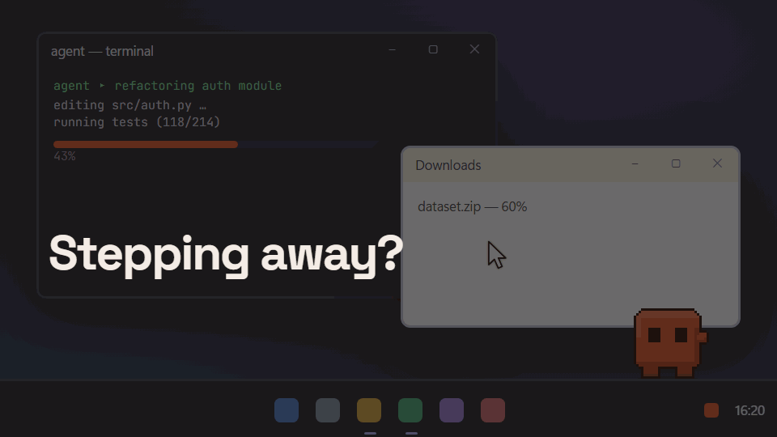 | 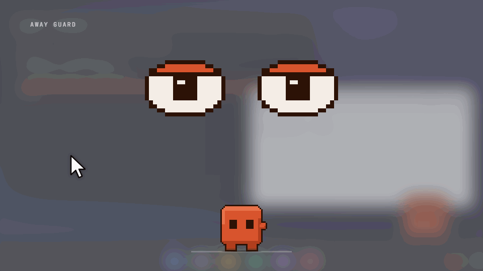 |

Get back in with Windows Hello or your guard PIN — click anywhere on the guard and the hidden PIN
field appears. Then **Peek** lifts it for a couple of minutes and comes back by itself, or the
faint **unlock** link ends it. Wrong PINs, Alt+Tab, the Windows key, Ctrl+Alt+Del or a window
stolen to the front black out every monitor except his red eyes. Win+L still locks Windows, and
unlocking Windows ends the guard, so a forgotten PIN never locks you out of your own machine. The
fog is never stored, the intrusion log lives in memory only, and the PIN is kept only as a scrypt
hash.

It is a strong deterrent for coworkers, kids and cats, not a vault: Ctrl+Alt+Del can't be blocked
(it blacks the screens out instead). See [Using him](docs/USING-HIM.md#the-screen-guard) for the
details and [Privacy](docs/PRIVACY.md) for what it keeps.

## Update and restart

**Update and restart**, last in the wheel's App group, brings him up to date and starts him again —
on every laptop you run him on, the way that copy was installed. A git checkout gets `git fetch
origin` and a fast-forward of its branch, never a merge, a rebase or a reset; local changes to his
files, or a branch that has gone its own way, are left alone and he says why. If the update changed
`requirements.txt`, pip installs it, from PyPI. The release build asks GitHub for the latest
release and, if it's newer, downloads and checks the zip, then swaps it in — all of it, or none of
it — and comes back. Already up to date, he says so and doesn't restart. He won't do it while the
screen guard is up or in the middle of a focus session.

This is the one network request he ever makes of his own, and only when you pick it. See
[Using him](docs/USING-HIM.md#update-and-restart).

## Documentation

| | |
| --- | --- |
| **[Getting started](docs/GETTING-STARTED.md)** | Install it with no Python experience |
| **[Using him](docs/USING-HIM.md)** | The launcher, the tray, ghost mode, sound |
| **[What he does](docs/BEHAVIOUR.md)** | Every behaviour, with the measured rates |
| **[Settings](docs/SETTINGS.md)** | All of them, with defaults |
| **[Providers](docs/PROVIDERS.md)** | Claude, ChatGPT, Gemini, and adding your own |
| **[Art and costumes](docs/ART.md)** | The sprite pipeline and how to draw a hat |
| **[How it works](docs/HOW-IT-WORKS.md)** | The parts that aren't obvious, and why |
| **[Troubleshooting](docs/TROUBLESHOOTING.md)** | When he misbehaves |
| **[Privacy](docs/PRIVACY.md)** | What he looks at and what he stores |
| **[Contributing](CONTRIBUTING.md)** | Branching, commits, and the six rules |
| **[Changelog](CHANGELOG.md)** | What changed in each release |
| **[Security](SECURITY.md)** | Reporting a problem privately |

## Requirements

Windows 10 or 11, Python 3.10+, and whichever assistant you point him at. Claude needs its
[desktop app](https://claude.ai/download); ChatGPT and Gemini just need a browser.

## Tests

```bash
python tests/run_all.py
```

27 suites, about 30 seconds. They boot a real `QApplication`, build a real sprite sheet, and in
several cases read geometry back out of Win32 to check what Windows actually believes — because
several of the bugs worth catching were "Qt thinks one thing and Windows thinks another".

## Licence

[MIT](LICENSE).

The sprite art is generated by code (`tools/gen_sprites.py`) rather than drawn by hand, so it is
covered by the same licence. `vendor/tesseract/` is the one exception - a trimmed copy of
[Tesseract](https://github.com/tesseract-ocr/tesseract), used unmodified as the OCR fallback
described [above](#drop-to-ocr), under its own [Apache-2.0 licence](vendor/tesseract/LICENSE).
Claude, ChatGPT and Gemini are trademarks of their respective owners; this project is not
affiliated with, endorsed by, or supported by any of them.
