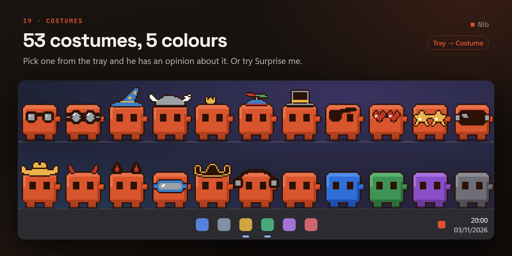

# Art and costumes

The sprite pipeline, the art contract, and how to add a costume.

[← back to the README](../README.md)

---

## Costumes and colours



Pick from the tray: **Costume**, grouped into submenus, and **Colour** (default, ocean, forest,
grape, charcoal) — or a costume from **Wardrobe…** on the
[tool wheel](USING-HIM.md#the-wardrobe). Both persist.

Put a costume on and he does a **quick-change**: a crouch, a hop, the outfit swaps at the very top
of it, and he lands and gives his opinion. The choice is saved the moment you make it and only the
visible change waits for the hop, so it always applies — asleep, in your hand or hidden, it just
goes straight on.

They cost nothing at runtime. Costumes are **not** baked per-frame — that would mean 170 frames per
hat. Instead every frame records **four anchor points**, and the costume is composited at the
matching one the first time that frame is built and cached. So a hat sits correctly on a hop, a nap
or a squat automatically, and flips with him when he walks left.

| Anchor | Where | Used by |
| --- | --- | --- |
| `head` | The centre of the top of his head | Hats, ears, horns, halos |
| `eyes` | The centre of his eye band | Glasses, patches, goggles |
| `neck` | Just below his mouth line, on his body's centre | Scarves, ties, pendants |
| `body` | The middle of his torso | Aprons, belts, packs |

All four are **measured off the finished silhouette** rather than hard-coded, so they track
breathing, squashing, hops and the tumble on their own.

> **The head anchor is not the topmost pixel**, and that distinction cost a bug. It used to be the
> centre of the highest solid row — which is his hand whenever an arm is raised. Measured across
> the sheet: **24 of 154 frames**, 16% of them, put every hat out on his wrist during the wave, the
> dance, the press-ups, the strain, the coffee and both new fidgets. It now walks down until it
> finds a row containing a contiguous run at least 12px wide. His head is 26px across and an arm is
> about 5, so the threshold has enormous margin and needs no per-frame tuning. That took it from 24
> frames to 2, and both survivors are `tumble` frames where he is genuinely rotated onto his side.

Colours are a remap of the body's four tones on the same cached frame. The eye black and the angry
red are deliberately left alone, so expressions read identically on every skin.

Costumes get the same 1px outline the body has — without it, the white santa brim vanished against
a light taskbar. That outline is also why **an enclosed transparent region is a bug**: it floods
any hole with dark, which turns a pair of hollow spectacle lenses into two black discs. Fill them.

Most costumes are painted **over** him. A few declare `"layer": "behind"` and are painted first,
with the creature drawn on top — that is the only way a backpack strap ends up behind his shoulder
rather than across his chest.

### He dresses himself, when there's a reason to

He owns 53 costumes and, left alone, wears none of them. The fix is deliberately **not** to cycle
them on a timer: the costume is a choice you make and it persists, so a timer overwriting it every
few minutes would make the menu decorative — and a hat that changes for no reason says nothing
about him or about what's happening. It'd be the only arbitrary thing in the app.

So a costume goes on when something *means* it, through the same path the reading glasses have
always used. Two kinds, and the difference is how long they last:

| | What | How long | Over yours? |
| --- | --- | --- | --- |
| **Winter** | Beanie | All season | No |
| **Spring** | Flower crown | All season | No |
| **Summer** | Sunglasses | All season | No |
| **Autumn** | A leaf on his head | All season | No |
| **Machine pinned** | Hard hat, while he fans himself | The length of that one reaction | No |
| **Knocking-off time** | Party hat, for the dance | The length of that one reaction | No |
| **A code editor** | Reading glasses | The length of that one reaction | No |
| **Focus session** | Headphones | For as long as the session runs | **Yes** |
| **Muted mic** | Earmuffs, for the wave | The length of that one reaction | **Yes** |
| **Focus session done** | Party hat, for the celebration | The length of that one reaction | **Yes** |

The party hat when the machine finishes a heavy job is a moment like the hard hat, so it respects
yours.

The moment costumes are keyed on the **moment**, not on the animation — so knocking off on a
Friday earns the party hat, and dancing *because* it's Friday afternoon, which is the identical
animation from the ambient pool, does not.

Seasonal is the ambient one: no expiry, worn until the season turns. It's meant to be predictable
rather than surprising — "it's December so he's got a beanie on" is something you can reason about.
A moment costume takes precedence while it lasts, so a code editor swaps the beanie for glasses and
swaps back afterwards.

**Yours wins, with three named exceptions.** If you have picked a costume, none of the above
fires — not a persona, not a moment, not the season. That rule predates all of them and every
automatic costume routes through the same check, because a hat that keeps vanishing reads as a
bug. The three exceptions are the ones marked **Yes**: headphones for a focus session, earmuffs for
the muted-mic wave, and the party hat when a focus session completes. Each one *is* the message —
"do not disturb", "you're muted", "done" — and lasts only as long as it does, then yours is back.
Two switches cover the rest: `auto_costumes` set to `false` takes off the seasonal ones, and
`persona_costumes` set to `false` takes off every row marked No — the season, the moments and the
reading glasses. Neither touches the three exceptions.

**Surprise me** at the top of the Costume submenu, and **Surprise costume** on the wheel, put a
random one on — never the one he's already wearing — and it counts as a choice, so it sticks, it
outranks everything above except those three, and it lands in the wardrobe's recents.

### The costume of the day

On top of the fifty-three, he has a **calendar**: one costume for every date of the year, 366 of
them with the twenty-ninth of February, and every one of them moves. Hearts bobbing on spring
antennae on Valentine's Day, a pi party cone on the fourteenth of March, a leap frog on the
twenty-ninth of February, a ghost peeking over his shoulder on Halloween; the days between are
themed on the season they fall in, and no two days share an idea.

It is the season rule made more specific, not a timer. The same date always gets the same
costume, so it is still something you can reason about — "it's the fourteenth of March, so he's
got the pi hat on" — and next year he wears it again. Movable feasts (Easter, Lunar New Year,
Diwali, Eid, Thanksgiving) do not land on one date, so none of them is pinned to one.

| | |
| --- | --- |
| **Where it sits** | Ahead of the season: with the calendar on, the date decides and the season is the fallback |
| **Yours wins** | Exactly as before. Pick any costume and the calendar never touches it |
| **Moments still win while they last** | A code editor still swaps today's costume for reading glasses, and back |
| **The switch** | `daily_costumes` — off, he goes back to the season's. `auto_costumes` off takes both off |
| **Wearing another day's** | **Costume → Calendar** in the tray: a submenu per month, each day by date and name. Picking one makes it yours, like any costume |
| **The wardrobe** | Shows today's, under **Today**, and not the other 365 — a wheel you have to scroll a year through is not a wardrobe |

They cost what the others cost — nothing per frame — and less to load. The art is on **one sheet
per month** (`assets/daily/costumes-MM.png`) beside `assets/daily_costumes.json`, and a month's
sheet is decoded the first time a costume from it is actually worn. So building him decodes no
calendar at all, and a costume change inside the same month decodes nothing new.

They are drawn as specs, one file per date, in `tools/daily_costumes/MM-DD.json` — the same
character-grid patterns as the wardrobe's, with a date, a title and two to four frames. The brief
for drawing one is [`tools/daily_costumes/AUTHORING.md`](../tools/daily_costumes/AUTHORING.md),
and two tools hold them to every rule a costume has:

```bash
python tools/check_costume.py tools/daily_costumes/03-14.json --preview review.png
```

checks a spec without Qt — the size, the frames, the enclosed-hole rule, off his face, on his
body, inside the frame — by dressing the real frames exactly as the runtime does, and renders a
review sheet: the poses on a light and a dark taskbar, then its frames side by side.

```bash
python tools/gen_daily_costumes.py
```

checks all of them again and writes the twelve sheets and the manifest. It refuses to write
anything if one fails or a date is missing: a hole in the calendar would leave him bare-headed one
day a year for no visible reason. `tests/smoke_daily_costumes.py` then checks every one through
the real runtime.

### Adding your own

Add an entry to `COSTUMES` in `tools/gen_sprites.py`: a character-grid pattern, an anchor point,
which of the four attachment points it uses, and a category for the menu. Then check it without
touching the sheet:

```bash
python tools/preview_costume.py my_costume.json preview.png
```

That renders your pattern onto seven real poses — standing, walking, mid-hop, sitting, asleep, and
the two that raise an arm past his head — over a light *and* a dark taskbar, which is where these
usually fail. `tools/integrate_costumes.py` folds reviewed batches back into `gen_sprites.py`.

The palette is wider than the body's: `D` dark, `W` white, `R` red, `G` gold, `B` blue, `N` green,
`K` grey, `P` purple, `M` pink, `O` brown, `A` charcoal, `S` silver, `F` flame orange, `T` teal.
Costumes live in their own PNG, so the body's seven-colour rule does not bind them — but the
no-partial-alpha rule still does, because the click mask comes from the composited frame.

Draw flat colour; **the sheet shades it for you**, lit from the top left as his body is. A pixel
on a costume's top or left edge gets a highlight, one on its bottom or right edge a shade, and a
one-pixel line stays flat so thin details don't turn to noise. White is only ever shaded. A `D`
drawn *inside* a costume (a hat band, a seam) becomes a dark tone of the colour beside it, so
only the silhouette keeps the hard outline that stands out on a light taskbar. `"shade": False`
turns it off for one costume.

A hat worn on top of his head also puts a **shadow** on him: the row just under it, darkened, on
his own pixels only, so it never shows on the air or changes his click mask. A costume that floats
(the halo) casts none; `"shadow": True/False` overrides either way.

A costume can **move**: `"frames"` lists extra patterns, the same size as `"pattern"` and on the
same anchor. It shows frame *n* of its own on frame *n* of whatever he is doing, so a propeller
turns with his idle sway and spins faster when he walks, without a clock of its own and without
redrawing him any more often. The preview adds a row that steps through them.

---

## The art pipeline

The mascot is **generated by code, not drawn in an editor.** `tools/gen_sprites.py` builds every
frame as integer pixel operations on 48×48 character grids, then writes the sheet, the manifest and
the costume sheet.

```bash
python tools/gen_sprites.py
```

```bash
python tools/validate_sheet.py assets/nib_sheet.png assets/frames.json
```

It also writes two review images: `assets/preview.png`, a zoomed contact sheet of every frame on a
checkerboard with a marker on each cell's baseline row, and `assets/banner.png`, the costume
showcase in the README.

The README's demo GIFs are separate: `tools/gen_demo_gif.py` composites frames straight from
`assets/nib_sheet.png` onto a drawn taskbar. Re-run it if you change a state it uses (the list is
at the top of that file) so the GIFs don't go stale against the art.

```bash
python tools/gen_demo_gif.py
```

**The art contract**, enforced by `validate_sheet.py`:

- 10×40 grid of 48×48 frames — 42 animation states, 170 distinct frames
- Exactly seven body colours, and **alpha strictly 0 or 255** — no anti-aliasing anywhere
- Every frame's soles rest on the same baseline row, so he does not jitter vertically between
  states. The mid-air hop frames are the only exemption, and they are checked to be *above* it
- Every frame carries `head` and `eyes` anchors, so any frame can wear any costume
- `walk_left` must **not** be in the sheet — it is mirrored at load time

**Every prop carries its own border.** The light detail tone `#F5EDE6` against a Windows 11 light
taskbar `#F3F3F3` is a contrast ratio of **1.04 : 1** — mathematically the same colour. Against a
dark taskbar it is 14:1, which is why nobody noticed: the art was designed on dark, and a 5×
checkerboard preview flatters it further.

The rule turned out to be about *placement*, not tone. Light pixels drawn **on his body** are fine
— the injury bandage reads perfectly either way. Light pixels **floating on the background** vanish.
So every floating prop now goes through `stamp_prop`, which rings it in the outline tone — the same
fix `outline_costume` applies to hats. It also clips at the baseline row, so a mug standing on the
floor cannot push the silhouette a pixel below the strip.

This was applied retroactively to the sleep Z's, the dance notes, the thought dots, the sparkles,
the seeing-stars and the football, all of which had been invisible on a light taskbar since they
were drawn. Nothing is lost on a dark taskbar: a 1px dark edge on a white note is invisible against
black.

Those rules are not pedantry. The hard-alpha rule is what makes the per-pixel click mask exact; the
baseline rule is what keeps his feet welded to the taskbar; the anchors are what make costumes cost
nothing.
