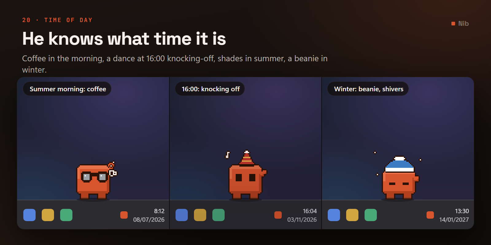
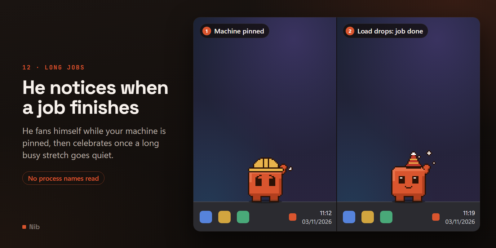
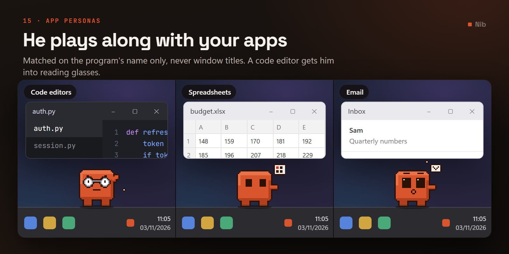
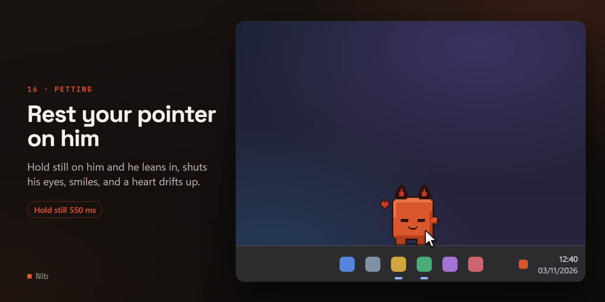
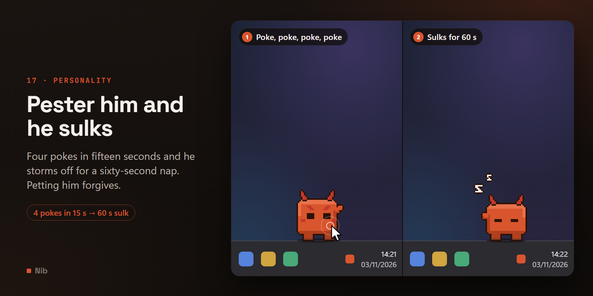

# What he does

Everything he does on his own, and everything he does about you.

[← back to the README](../README.md)

---

## What he does on his own

He is busy by default: **roughly 90% of his time** is spent walking or doing something, with only a
sub-second beat in between. Two things genuinely stop him: **sleeping off a sulk**, and **sitting
down to wait when you step away** — and being briefly dazed if you drop him. Nothing else.

Between walks he picks a random antic, weighted, never the same one twice in a row:

| Antic | What you see |
| --- | --- |
| **Eyes follow your cursor** | Really tracks your pointer, live. Triggered on a wander beat when the pointer is within `eye_track_distance_px`, held 1.8–3.2s, then a 7s cooldown |
| **Look around** | Eyes dart left and right — checking whether anyone is watching |
| **Wink** | One eye shuts and he points straight at you |
| **Sparkle** | Eyes glint and sparkles pop overhead |
| **Heart eyes** | Eyes turn to hearts and one floats away |
| **Football** | Knees a ball back up as it drops, eyes tracking its height |
| **Dance** | Side-to-side bop with music notes |
| **Workout** | Deep knee dips, eyes screwed shut on the hard one |
| **Hop** | A squash-and-stretch jump that genuinely leaves the ground, and always lands before he moves on |
| **Sit & dangle** | Sits low with his legs swinging forward off the edge |

The four "eyes" antics are weighted **2.5× higher while your cursor is nearby**, so the
attention-seeking ones turn up when there is somebody to seek attention from. Cursor-tracking
pre-empts the roll entirely when it is off cooldown.

The cursor-tracking is not a canned animation: nine eye directions are baked into the sheet as a
3×3 grid, and the app picks the frame matching where your pointer actually is.

When an antic's time is up he finishes cleanly rather than freezing mid-gesture. A looping one
stops once the frame on screen has his feet down — only the hop ever leaves the ground — at most
one more cycle later. A one-shot (a sneeze, a startle, the task-finished celebration) plays to its
last frame, even at night when everything ambient runs slower. The durations themselves are not
stretched.

He **waves** when your cursor comes within `hover_wave_distance_px`.

### Micro-fidgets

Everything in the table above is a **set piece**, and a creature made entirely of set pieces reads
as one waiting for its next cue. So there are three deliberately unremarkable things too, each
under a second:

| Fidget | What you see |
| --- | --- |
| **Scratch** | Works away at the side of his head, squinting through it |
| **Foot tap** | One foot comes up and taps back down; he dips a pixel as it lands |
| **Check his watch** | Raises an arm and peers at a wrist he does not have |

A fidget you *notice* is not a fidget, which is what makes them hard to tune — short antics get
picked as often as long ones and finish three times sooner, so a modest-looking weight can quietly
become most of what you ever see. Measured over two simulated hours with a user glancing at him
every couple of minutes, median of three runs: **13% of the time he spends on antics, one roughly
every 58 seconds** (49–68s across the runs; every 33s on `hyper`, 30–41s; every 92s on `chill`,
86–94s). Set `fidgets_enabled` to `false` to drop them.

> That measurement took two attempts. The first one reported `sit_dangle` at 79% of his time and
> `look_around` at 140 an hour, which looked like a catastrophic tuning error and was in fact the
> [attention arc](#when-youre-here-and-ignoring-him) working exactly as designed — two simulated
> hours with *zero* interaction puts him in the stage-3 sit, where he sits and glances up every
> 21 seconds. The harness was measuring a mascot being ignored all afternoon.

### Things that happen to him

Everything above is either a reaction to you or an activity he chose. These three are
**involuntary**, which is exactly why they sell him as alive — nobody decides to sneeze.

| | What | How often |
| --- | --- | --- |
| **Sneeze** | Rears back, sneezes, and the recoil knocks him a few pixels backwards | **Twice an hour** |
| **Trip** | Stumbles mid-stride and catches himself | **Three times an hour** |
| **Hiccups** | Three to five little jolts, after you have thrown him hard | Whenever he lands hard |

The rates are **scheduled, not rolled.** A per-decision chance would make the real frequency depend
on how often he happens to reach a decision point — which changes with the personality preset, the
antic chance and how much walking he's doing. Drawing the next occurrence from a target interval
means "twice an hour" is twice an hour whatever else is going on. Measured over six simulated hours
on four different presets, three runs each: **1.7–2.2 sneezes and 2.5–3.5 trips an hour**, with no
drift between `chill` and `hyper`.

The trip **arms** rather than fires: a stumble only means anything mid-stride, so when it comes due
it waits for the next walk. It never happens while he's storming off — a tantrum undercut by a
pratfall reads as a bug rather than as comedy.

Set `quirks_enabled` to `false` to switch all three off.

**Tray → Do something** plays one now. Deliberately not *"make him sneeze"*: a control for one
specific reflex would turn the involuntary three into puppet strings, which is the one property
that makes them work. Asking him to do *something* keeps the character and still lets you see
them without waiting half an hour. Measured over 400 presses: **72% land on one of the rare
four** (sneeze, trip, hiccups, spin) and the rest come from the ambient pool, so it doubles as a
way to browse what he can do. It never consumes the next naturally scheduled one.

### He has an opinion about his hat

Put something on him from the tray, the wheel or the [wardrobe](USING-HIM.md#the-wardrobe) and he
hops into it: a crouch, the hop, the outfit swaps at the very top, and he lands and reacts to it.
From Settings it goes on at once, since he's behind the window, and he reacts all the same.

Some costumes have a reaction of their own: the traffic cone gets a double-take, the crown a smug
wink, the cat ears heart eyes. Everything else goes by its category — a hat gets a scratch under
the brim, a head piece a sparkle, eyewear a look about, neckwear a wink, work gear press-ups, and
anything on his back a stretch to shrug the straps on. Taking it off gets a look at himself.
Thirty-two of the fifty-three used to get that same look; now no one reaction covers more than ten.
Change his colour and he sparkles. It costs **no new art at all** — the hop is his greeting hop,
and every reaction is an animation he already had.

Until this, he owned fifty-three costumes and was completely indifferent to every one of them.
`costume_reactions` switches all of it off: no hop and no opinion, the costume just appears.

### Small things

- **Scroll the wheel over him and he spins.** There is no reason for this. It reuses the tumble
  frames and it is on a short cooldown so a long scroll gets one spin, not a blur.
- **One poke gets a flinch.** Dismissing the bubble used to be completely invisible until the
  fourth one, at which point he stormed off with no build-up at all. Now each one below the
  threshold gets a brief glare, so the escalation is legible.
- **He looks at what you drop on him.** A glance down at the pointer before he gets on with it.
  The deep link fires **immediately** — only his animation is sequenced behind the glance, so
  nothing you asked for is ever delayed for a cosmetic beat.

### He stands on things

There is a soft **contact shadow** under his feet. Without one he does not read as standing on the
taskbar so much as hovering a pixel above it.

It is painted by Qt rather than baked into the sprite sheet, and that is forced: a shadow has to be
partly transparent to work over a taskbar whose colour nobody knows in advance, and
[the art contract bans partial alpha](HOW-IT-WORKS.md#clicks-pass-through-empty-space) precisely because the
per-pixel click mask is derived from it. So the shadow's own area has to be added to that mask by
hand — which is the same failure the peek fix exists to prevent, and therefore something to
measure rather than assume:

- **+184 physical pixels of input region, 6% of what he already occupies**, at `sprite_scale=2`.
- All of it in the **bottom 5 rows of a 96px window**, none of it below the window or past either
  side. Read back from `GetWindowRgn`, not from what Qt believes.
- With `shadow_enabled` off the region is **byte-identical** to what it was before the feature.

It fades out completely wherever a shadow drawn inside his own window would be a lie: while he is
in the air, while he is in your hand, and while he is peeking (where the window is cropped to the
top of the bar anyway). Landing **spreads and thins** it — the one bit of squash-and-stretch he
has, and it costs nothing because it is drawn rather than drawn by hand.

Mid-hop it shrinks and fades on its own. That is not a special case: the sheet reports each frame's
own *lift* — how far its lowest opaque row sits above where the soles normally rest — read straight
off the pixels. Any future airborne frame gets the same treatment without being told.

On a dark taskbar it is very nearly invisible, which is correct rather than a bug: it multiplies
down whatever is behind it, and a real shadow on a dark floor does the same.

### Blinks, and what they tell you

He doesn't have one blink, he has three — and **which one he uses is a mood, not a coin toss**:

| Blink | What it looks like | When |
| --- | --- | --- |
| **Single** | One frame, 120ms. Punctuation | Any time |
| **Double** | Two closes in quick succession | Any time, a little more in the daytime |
| **Slow** | Lids at half mast, held. Tired | **55% of blinks at night**, 5% at midday |
| **Startle** | A jolt upward, wide eyes, round mouth | Something appeared in front of him |

That weighting is the entire point. A sleepy blink at eleven in the morning says nothing; the same
blink at midnight says everything. Measured over 3,000 samples: at 02:00 slow blinks outnumber
ordinary ones, and by midday they're down to 4%.

He blinks standing about, standing on a window, and while the ask bubble or the tool wheel holds
him — the same clock and the same time-of-day mix in all three. Aiming at a tool on the wheel
pauses it, because his eyes are busy following you.

The **double** blink costs no new art at all — it's frames 3 and 0, which already existed, played
back at different timings.

The **startle** deliberately sits *after* the app-persona checks. Putting it first meant it
swallowed every persona: switching to VS Code got a jump instead of glasses and typing. It's now
what he does when he has nothing more specific to say about an app, on a short cooldown so a burst
of alt-tabbing gets one jump rather than a twitch.

### Expressions

Six named expressions, defined once as small brow and mouth deltas and **reused across unrelated
reactions** — "determined" is the same four pixels whether he's typing, doing sums, or shoving at a
window.

| | Eyes | Reused by |
| --- | --- | --- |
| **surprised** | Wide, raised brows, round mouth | The startle; post arriving |
| **smug** | Half-lidded, one brow up, smirk | The wink |
| **sleepy** | Half-lidded, brows falling outward | Wilting in the heat; slow blinks |
| **dizzy** | Crossed eyes, wavy mouth | Landing on his head |
| **love** | Hearts, small smile | Heart-eyes |
| **determined** | Brows driving toward the nose, flat mouth | Typing; straining at a window |

**He has no mouth at rest**, and that's deliberate — at 48px the eyes carry everything, and a mouth
on every frame flattens the silhouette. It appears only where an expression calls for one.

Worth knowing if you edit these: `sleepy` and `determined` are the same shape mirrored, and getting
them backwards is silent. A brow low on the **inner** side reads as cross; low on the **outer**
side reads as tired. The first version had them swapped — sleepy looked furious and determined
looked worried — which is why there's now a test that measures the actual slope of the drawn
pixels rather than trusting the pattern names.

---

## He knows what time it is



He notices the clock, the calendar, the season, and how hard your machine is working. All of it
comes from the local clock or one cheap Windows counter — **nothing here touches the network or
reads a single file of yours.** See [Privacy](PRIVACY.md#privacy).

This is deliberately built as two separate mechanisms, because that is what stops "he seems aware"
from turning into a dozen new states that fight each other.

### Moments — things he does once



One-off reactions to something specific. They are priority checks, not entries in the antic pool.

| Moment | When | What he does |
| --- | --- | --- |
| **Morning stretch** | The first time he sees you on a new day, from 05:00 | Reaches up on tiptoe |
| **Yawn / coffee** | 05:00–09:30, now and then | Yawns with a puff of air, or fetches a mug and sips it |
| **Knocking off** | Weekdays, within 15 min of `workday_end` (**16:00**) | A proper dance |
| **The week's over** | Friday, 30 min after `workday_end` | Flops down and dangles his legs |
| **Machine pinned** | System load sustained over `cpu_busy_percent` | Wilts and fans himself, sweating |
| **Task finished** | A long sustained-load stretch drops back to quiet | Winds up, punches the air, holds a twinkling sparkly beat, settles into a smug grin — with a cheer if sound is on |
| **Seasonal** | Every 90 min or so | Winter: shivers in falling snow. Autumn: watches a leaf tumble past |
| **Day milestone** | The 7th, 30th, 100th and 365th day he has seen you — once each, ever | The task-finished party, hat and cheer included |
| **Focus streak** | Your third finished focus session of the day — once a day | The same party |

Three rules keep these from stacking up, and each came out of a measurement rather than a guess:

- **One shared budget.** Every moment draws on the *same* 45-second cooldown. Eight independent
  triggers will eventually land in the same second, and the result reads as a short circuit rather
  than as a character.
- **Once-a-day means a window, not just a flag.** The knocking-off dance only fires *within 15
  minutes of* 16:00. Without that, launching him at six in the evening would fire the four o'clock
  celebration two hours late — and so would waking the machine from sleep. The latches live in
  `config.json`, so "once a day" survives a restart instead of meaning "once per run".
- **The per-kind cooldowns are long, because the first ones were not.** Simulating a whole day
  showed the seasonal moment firing **202 times** — one every seven minutes — and the morning yawn
  66 times. Each was individually correct, and collectively a nervous tic. They now sit at 90
  minutes and an hour, which works out at about a dozen seasonal flourishes and five yawns a day.

**Summer is missing from that table on purpose.** Its animation *is* the machine-under-load one —
he fans himself either way — so if both fired you could no longer tell "it is July" from "your
machine is pinned", and neither would read as anything. Summer therefore stands aside while
`cpu_reaction_enabled` is on, and takes the animation over when it is off.

**Machine pinned and task finished read the same sensor two different ways.** One is a *level* —
he fans himself for as long as load stays sustained above `cpu_busy_percent` — and the other is an
*edge*: it only fires once that stretch has run for a real while (45 seconds, not the fan's 6) and
then genuinely drops back to quiet, so a build's ordinary dips between compile units do not read as
it finishing early. They cannot overlap: by the time there is anything to celebrate, load has
already dropped, so fanning has already stopped.

**The two moments from [what he remembers](USING-HIM.md#what-he-remembers)** have no window and no
chance: each waits on its latch (`last_milestone_days`, `last_focus_streak_date`), so a restart on
the seventh day does not throw the party twice, and being beaten to the slot by another moment only
delays it. Neither fires before 05:00, so a day that begins at
midnight waits for morning. The milestone counts **days he has actually seen you**, not days since you met — a
fortnight's holiday does not make a month. Both share the task-finished party *and its 3-minute
cooldown*: every finished focus session already ends in that party, so without the cooldown the
third would get two in a row. Instead the streak's waits a moment and follows on. In a simulated
day with 30 days and a bond near the top in memory, the milestone fires exactly once and everything else
fires as often as it does on a fresh install — see `tests/day_rate.py`.

### Mood — things that change how he already behaves

Mood never fires anything. It leans on the weights of the antics he already has and on how fast he
plays them, which is why **none of this cost a single extra frame of art**:

| When | What changes |
| --- | --- |
| **Late night** (22:00–05:00) | Everything runs at **0.7× speed** — walking included — and he mostly sits about. Dancing drops to 0.15× weight, press-ups to 0.2× |
| **Evening** (18:00–22:00) | 0.87× speed, less exercise |
| **Morning** | Calmer; he looks around more and dances less |
| **Friday afternoon** (from 13:00) | Dancing weighted **3× higher**. He can feel it coming |
| **Spring** | Sparkles, hops and heart-eyes weighted up |
| **Summer** | Too hot for press-ups and football |
| **Autumn** | Sits and looks around more |
| **Winter** | Hops and dances to keep warm |

The night slowdown is applied to the walk *as a whole*, not to the animation alone — his stride
length is derived from animation progress, so scaling both together slows him down without his feet
starting to slide. See [The feet do not slide](HOW-IT-WORKS.md#the-feet-do-not-slide).

**Spring has no animation of its own** — it is bright and bouncy purely by weighting, and so, in
practice, is summer.

> **A note on the CPU reading.** It is *aggregate* across all cores. On a 16-core machine one
> pegged core reads as about 6%, so a heavy single-threaded build will not trip a 70% threshold —
> that is measurement, not a bug. The reaction is also a brief antic rather than a state he sits
> in, because reacting to load by animating harder is a feedback loop. He costs about 1% himself,
> and that 1% is in the number.

Set `world_enabled` to `false` to switch this whole section off.

---

## How the day went

Everything above is **derived**. The time of day, the season, whether the machine is pinned: all of
it is recomputed from your clock on every launch, which means two sessions an hour apart are
identical in every respect that matters. Nothing you did in the first one reaches the second.

This is the exception, and the only part of him that is. One number — **spirits**, from −1 to +1 —
moved by the things you do to him and fading back to neutral on a half-life:

| What you do | Which way |
| --- | --- |
| Pet him | **+0.22** — the big one, and the only kindness he has |
| Send a prompt | +0.10 |
| Come back after being away | +0.05 |
| Dismiss the bubble without sending | −0.09 |
| Push him past the annoyance threshold | **−0.30** |
| Drop him from a height, or into the end of the strip | −0.18 |
| Ignore him until he gives up and sits down | −0.12 |

**It never fires anything.** Exactly like the time-of-day mood it composes with, it leans on the
weights of the antics he already has and on how fast he plays them. In good spirits he hops, dances
and sparkles more and sits about less, and runs 8% quicker; flat, he sits, looks around, checks his
watch, slows to 90%, and blinks the heavy slow blink far more often. A mascot with a *new*
behaviour unlocked by an invisible counter is one you cannot reason about; a mascot who is
noticeably bouncier after a good morning is one you can.

**It keeps fading while he is closed.** The value is written with a wall-clock stamp, so leaving
him thoroughly fed up and coming back tomorrow finds him over it. Default half-life is six hours
(`mood_half_life_h`).

Two details that are less obvious than they look:

- **Bad news always lands in full; good news gets harder.** A nudge pushing him *further* from
  neutral is tapered by the headroom left, squared — so headroom after *n* events is `1/(1 + n·d)`
  and the ends of the range stay genuinely out of reach. A nudge pulling him *back* toward neutral
  always lands at full strength. Fifty pets leave him around +0.91, not pinned at +1.
- **It barely touches the disk.** The value moves on every tick and the config flushes every ten
  seconds, so it is stored quantised to hundredths: an untouched mascot stops rewriting the file
  within a couple of minutes of the last thing that happened. Measured at **0 writes over ten
  simulated minutes** of an idle mascot.

A clock that jumps *backwards* — a timezone change, an NTP correction, a dual boot — is treated as
zero elapsed rather than being allowed to amplify the mood instead of fading it.

Set `mood_enabled` to `false` and it reports a flat zero, contributing nothing anywhere.

**Where you can read it.** As a word, never the number: *delighted*, *in good spirits*, *fine*,
*a bit flat* or *thoroughly fed up*. It is the tray icon's tooltip whenever nothing more pressing
(a focus countdown, a live mic or camera, a pinned window) has it — `Nib — fine` — and the
"Right now" line on **Settings → About him**. Both use his `name`. With `mood_enabled` off the
word is always *fine*.

**What he remembers is separate.** The mood is one number about *today*; the longer story — the
days you have shared and how many pets, prompts and focus sessions — is kept in `memory.json` by
`memory.py`, and like the mood it never fires anything on its own. See
[What he remembers](USING-HIM.md#what-he-remembers). **Forget everything** wipes it and resets the
mood to neutral with it.

A few things *read* it, and each adds a beat rather than a new behaviour: the
[day milestone and focus streak](#moments--things-he-does-once) moments, and two touches on his
greeting when you come back (below). With `memory_enabled` off none of them happen.

---

## App personas



Building on his existing app reactions: switch to certain apps and he plays along. Matched on the
**executable name only**, never a window title, and rate-limited to one reaction per 12 seconds so
he does not respond to every alt-tab.

| You switch to | He does | Wearing |
| --- | --- | --- |
| **VS Code** (and Cursor, VS, the JetBrains IDEs, Sublime, Zed…) | Hammers away at an invisible keyboard, eyes locked in | **Reading glasses** |
| **Calculator** | Watches `+ − × =` drift past, eyes flicking between them, then gets the answer | — |
| **Excel** (and other spreadsheets) | Points at a little grid and walks a red cell around it | — |
| **Email** (Outlook, new Outlook, Mail, Thunderbird…) | An envelope pops up and he points it out to you | — |
| **Claude** | Hearts, sparkles or a wink — he is pleased to see it | — |
| Anything else | A glance around, half the time | — |

**The glasses are temporary and yours always win.** If you have chosen a costume from the tray, a
persona will never overwrite it — a hat that keeps vanishing reads as a bug, not a feature. Set
`persona_costumes` to `false` to keep him bare-headed regardless.

Putting the glasses on rebuilds the sprite sheet, which measures **~3 ms** — and ~18 ms even in the
pathological case where every one of the 126 frames' pixmaps *and* click masks have to be rebuilt.
Against a 12-second cooldown that is free, which is why the personas get to wear things at all
rather than being animation-only.

**Store apps needed a workaround.** Windows does not give Calculator, Mail, Photos or Settings
their own top-level window — the shell hosts them all inside `ApplicationFrameHost.exe`. Asking who
owns the foreground window names the host, so without this every Store app would look like the same
program. Nib walks the window tree to the first child owned by a different process. Measured on
this machine: the frame reports `applicationframehost.exe`, its child reports `calculatorapp.exe`.
The walk looks at the window *hierarchy* and at process IDs — never at what any of those windows
say.

**The list is extensible.** A hard-coded table of executables is inevitably incomplete, so
`persona_apps` in `config.json` is merged over the top and wins on a clash:

```json
"persona_apps": { "blender.exe": "dance", "code.exe": "sparkle" }
```

The value is any animation state name from `assets/frames.json`; an unrecognised one is ignored
rather than being fatal.

---

## Playing with what's around him

Two things that make the desktop feel like a place he lives in rather than a backdrop.

**He peeks over the taskbar.** Every so often he ducks down behind it until only his head and eyes
show over the top edge, has a look around, and rises again.

**He heaves at whatever is hanging over him.** If a window's bottom edge is dangling within about
a body-height above his head, he walks over to stand under the middle of it, braces, and shoves
upward with everything he has. **Nothing happens.** He gives up and wanders off. That is the joke.

### He never moves your windows (with one named exception)

This is worth being exact about, because it is the obvious thing to assume he does more of than he
actually does.

**Nowhere in Nib does he move, resize, or restack another application's window, except the one
place he is explicitly asked to.** Finding and following a window - the overhead-window gag, and
[dropping him onto one](USING-HIM.md#pinning-him-to-a-window) - is always read-only: rectangles
only, never a title, never any content. `find_ledge`, `find_window_at` and `track_window` are each
individually verified to be read-only and never read a title. The strain at an overhead window
visibly fails because it is not connected to anything - that gag predates the exception below and
is still exactly as toothless as it always was.

The one exception is deliberate and narrow: **setting him down gently on a window pins that window
on top.** A real flick is judged the same way a throw is and flies through the window instead of
sticking, and even a genuine drop does not pin immediately - he has to stand there undisturbed for
a few seconds first, so a brief landing on the way to somewhere else never triggers it. Once it
does pin, it is a single `SetWindowPos` call, in one function (`win_integration.set_topmost`), that
never moves the window, never resizes it, never steals its focus - only its z-order changes, and
only for the one window you explicitly perched him on. A test checks that this call is the *only*
place anything like it appears anywhere in the codebase outside that function, so the exception
cannot quietly widen to cover something it was never meant to. Because a pinned window can end up
fullscreen and cover him entirely, the tray icon carries a small marker for as long as one is
pinned, so the state stays visible even when he is not.

Everything else stays exactly as absolute as before. That was a deliberate choice rather than a
limitation: moving someone's window is the one thing here that could actually cost them something
— Windows 11 snap layouts have no clean API to detect, so a nudge can silently drop a half-snapped
window out of its layout — which is why the *general* rule holds everywhere except the one gesture
a user chose specifically to invoke it.

### How the peek works

He is topmost. So is the taskbar. Racing the shell for z-order is a fight you lose eventually, and
losing it would leave him stuck behind the bar with no way back. So he doesn't play that game:

```
window rect   = (x, rest_top + sink, w, baseline − (rest_top + sink))
pixmap        = drawn at (0,0) and simply clipped by the shorter window
```

He sinks, his window's bottom edge stays welded to the taskbar's top edge, and everything below
that line is never painted in the first place. No z-order calls, and no state he can get trapped in.

One thing that does have to be kept in sync is the **click mask**. Qt does *not* intersect a mask
with the widget rectangle — measured with `GetWindowRgn`, a full-height sprite mask on a 68px
window left **26px of input region hanging below the window**, over the taskbar, where he would
have quietly swallowed clicks meant for the bar. So the mask is explicitly clipped to the visible
height, and there is a test that reads the real Win32 window region back to prove it.

The sink depth is **46% of his visible height** at any sprite scale. That number came from
rendering the sink from 0 to 36px over a real taskbar colour and looking at it: any less and he is
merely standing low, two pixels more and the bar starts eating his eyes. While peeking he holds the
upward frame of the eye-direction grid, so he is actually looking over the edge.

### Cost

Finding something overhead means enumerating top-level windows, which is the most expensive probe
in the whole app — a Python callback per window. So it never runs on a timer. Behaviour raises a
flag when he is *in the mood* to look, and only then does the app enumerate.

**The cooldown is spent on the look, not on the find**, and that distinction is the whole feature.
The first version charged it only when a window *was* found overhead — which on an ordinary
desktop is rare — so the flag never latched off and the enumeration ran on essentially every
700ms poll instead. Measured over a simulated hour:

| | enumerations / hour |
| --- | --- |
| Charging only on success (the bug) | **4,564** — 89% of all polls |
| Charging on every look (fixed) | **38** when nothing is overhead, **4** when something is |

A 15-minute cooldown after he actually has a go, 90 seconds after a look that found nothing — long
enough to be cheap, short enough that a window appearing above him is noticed within a minute or
two.

Set `play_with_windows` to `false` to switch both off.

---

## How he reacts to you

- **He roams every screen.** With `roam_all_monitors` he walks off one monitor and onto the next,
  stepping up or down onto each screen's own taskbar as he crosses.
- **He reacts to the app you switch to** — hearts, sparkles or a wink when Claude comes to the
  front; a glance around for anything else, on a cooldown so he does not react to every alt-tab.
- **He waits while you are away.** After `away_after_s` with no keyboard or mouse he sits down and
  dangles his legs, then greets you when you come back — sized by how long you were gone: a quick
  wave under 10 minutes, the hop up to four hours, and after a night away a stretch, a yawn and
  then the hop. (Gone *at least* `away_after_s` to count, so with the default 150 the wave covers
  2½ to 10 minutes.) This is deliberately *sitting*, not sleeping — only being pestered puts him
  to sleep. Two things he [remembers](USING-HIM.md#what-he-remembers) add a beat at the end: on
  a morning after a heavy day the overnight wake-up finishes with a coffee, and once he knows you
  well — a month or so of days together and a few hundred pets, the bond `memory.py` calls
  *close* — the hop is followed by heart eyes. The wave never changes: a coffee break is not a
  reunion.
- **He watches the wheel.** His eyes follow the tool you're aiming at, the tools that give him
  nothing to do get a short beat when picked, and putting the wheel away without choosing gets a
  head scratch. See [the tool wheel](USING-HIM.md#the-tool-wheel).
- **He notices being ignored.** See below — that's the other case: you're right here, and none of
  what you're doing involves him.

### Petting him



Rest your pointer on him and hold still. He leans into it, shuts his eyes, smiles, and a heart
drifts up.

Everything else in this app is something he does *to* you or *about* you. This is the one thing you
do to him — and until it existed the whole interaction model ran one way: poke, poke, poke, sulk.
There was **no way to be kind to him at all**.

So it does the two things that matters:

- **It forgives a poke** every 1.2 seconds it runs. It is the only thing besides sending a prompt
  that takes accumulated annoyance back off, and the only one that works while he is already cross
  about something.
- **It is worth twice a sent prompt** to [how the day went](#how-the-day-went).

The trigger is deliberately stricter than the wave's: the pointer must be **on him**, not merely
near, and it must hold still for `pet_hold_ms` (550ms, with 3px of tolerance because a hand resting
on a mouse drifts). A wave costs nothing if it misfires; leaning into a hand that is not there does
not read as affection, it reads as a bug.

**The wave stands aside for it.** That is load-bearing rather than cosmetic: the wave fires the
instant a pointer comes within `hover_wave_distance_px` — 120px — so a pointer coming to rest on
him is already deep inside wave range, and the wave got there first every single time. Checked in
the obvious order, petting was literally unreachable. A hand resting *on* him is not a hello from
across the desk anyway.

It stops when you take your hand away, or after six seconds so an abandoned pointer does not trap
him in a trance. Afterwards **your pointer has to actually leave him** before another can start —
a timer alone would have let a cursor parked on the taskbar pet him on a loop forever.

It works in both directions: bring your hand to him, or leave your hand somewhere and let him
wander into it. Nothing special handles the second case — the stillness clock is in screen
coordinates, so it is already satisfied by the time he arrives.

Not while he is asleep, cross, hidden, in your hand, mid-throw, or while you are away. Set
`petting_enabled` to `false` to switch it off.

### The inline calculator

Type an arithmetic expression or a unit conversion into the bubble — `12 * 7`, `sqrt(16)`,
`3 miles in km` — and he answers it there instead of sending it on.

As you type, a recognised calculation gets a small answer line under the input, in his accent
colour, and the hint swaps from "Enter to send" to "Enter to calculate" — purely visual, nothing is
sent anywhere while you're still typing. Pressing Enter on it closes the bubble exactly like a
normal send, but **nothing is launched**: no `claude://`, no browser, no network request of any
kind. Instead a toast appears next to him with the answer — not the
[sign he holds up](USING-HIM.md#the-snippet-billboard), which already means something else, the
pocket — clickable to copy just the number, and he plays the "counting" animation already defined
for the Calculator persona in [App personas](#app-personas) — reused as-is, so the reaction costs no
new art.

A recognised-but-broken calculation — `12 / 0`, `sqrt(-1)`, `3 miles in kg` — is still answered
inline, with a plain-English explanation in place of the number ("Can't divide by zero", "Can't
convert length to weight"), rather than being sent to the assistant as a prompt. It does not play
the counting animation, since only a clean answer earns that, and there is nothing worth offering to
copy. Anything that only looks like a calculation — "why is the sky blue", "10 minutes in advance",
a bare `42` on its own — is left alone and goes to the assistant exactly as before; the conversion
grammar only fires when both sides name a unit it actually recognises, so one recognised unit next
to an ordinary word reads as a sentence, not a mistake.

**A calculation is not a sent prompt, as far as the personality model is concerned.** It does not
enter prompt history, does not touch `last_prompt`, does not earn the +0.10 mood nudge a sent
prompt does, does not clear accumulated annoyance, does not play the send sound, and closing the
bubble right after one is not counted as a poke. It does still reset the being-ignored clock — the
same noticing every real interaction goes through, [see below](#when-youre-here-and-ignoring-him) —
so a calculator-heavy stretch never reads as ignoring him.

Set `calculator_enabled` to `false` to switch off both the live preview and the interception: a sum
typed with it off is just sent to the assistant like any other text, no different from before this
feature existed.

### When you're here and ignoring him

"Away" means no input at all. This is the opposite: you're working, and none of it is aimed at him.

| | After | What he does |
| --- | --- | --- |
| **1** | `attention_after_s` (4 min) | Starts glancing your way — the attention-seeking antics get weighted up 2×. Invisible unless you're watching |
| **2** | 8 min | **One** unprompted wave, even though your cursor is nowhere near him |
| **3** | 14 min | Gives up. Sits down to wait, glancing up every 20s or so |

**And then it stops.** It never escalates past the third stage — which is both less irritating and
truer to life, since real attention-seeking peaks and subsides. There is deliberately **no stage
where he walks over to your cursor**: a mascot that leaves its spot and comes at your pointer is
the version of this that gets an app uninstalled.

That last stage uses the same sitting animation as the away-wait, so he **glances up periodically**
— that's the only thing distinguishing "still hoping" from "settled in until you get back".

**Anything aimed at him resets the clock**: clicking, double-clicking, dragging, sending a prompt,
dismissing the bubble, dropping a file on him, the right-click menu, your cursor coming close
enough to make him wave — and **the global hotkey**, which is the easy one to miss, since it opens
the bubble at your pointer without going anywhere near him. Somebody using the shortcut all day is
exactly the person he must not decide is ignoring him.

It's **suppressed** while you're away, while he's paused, asleep, cross, hidden, being dragged or
mid-flight — and while **the machine is pinned**, because that's the worst possible moment to ask
for attention. The clock doesn't run while you're away either, or coming back from lunch would
drop you straight into the last stage.

Set `attention_enabled` to `false`, or `attention_after_s` to `0`, to switch it off.
- **He hides for fullscreen.** A genuine fullscreen window (game, video, slideshow) on his monitor
  fades him out; he fades back when it exits. That is the **only** automatic hide. There is no
  screen-share detection, by design. A fullscreen app that lasted more than about 20 seconds gets
  a wave on the way back, at most once a minute — alt-tabbing in and out of a game is one return,
  not a dozen.
- **Hide for 10 minutes** from his right-click menu sends him away without pausing him. He comes
  back on his own with a wave, and the snooze outlasts a fullscreen app.

### Focus sessions

**Start focus** in the tray menu holds him in the working pose — legs planted, typing — for
`focus_duration_min` (25 by default), the same reused animation that runs briefly after every sent
prompt. He puts on headphones for the duration regardless of whatever costume you had picked -
"do not disturb" reads the same way on a mascot as it does on an actual desk - and every so often
the typing gives way to a burst of press-ups instead, existing art rather than new frames, so a
25-minute hold does not read as one animation frame left running for the whole length of it. He
reasserts the pose (headphones included) the instant anything knocks him out of it, the same
reassertion the [snippet billboard](USING-HIM.md#the-snippet-billboard) uses, so the hold reads as
*sustained* rather than replayed.

A small always-on-top readout floats above him for as long as the session runs - a countdown and a
progress bar that turns red in the last minute - independent of the tray tooltip, which still shows
the same countdown for whenever the tray happens to already be where you're looking.

It sits in the same priority slot as the away-wait and the snippet billboard, and loses to both:
whatever's holding the sign wins, then whatever's waiting for you to come back, then the focus
pose. Going idle past `away_after_s` pauses the countdown rather than spending it while you're not
there — the one thing that does pause it, since a session is a length you committed to, not
"behaviour" to freeze for a fullscreen game or a pause on the mascot itself.

Getting him properly cross (four pokes in fifteen seconds by default) or calling him over with
**Come here** cancels the session outright rather than pausing it — both relocate or interrupt him
in a way the hold cannot survive honestly, so it ends there instead of a tray tooltip going on
claiming he's "focusing" while he's visibly storming off or walking to your pointer; the floating
readout comes down the same moment. Reaching zero on its own is the only path that pays out: a mood
lift, its own completion chime if sound is on — calmer than **Task finished**'s cheer on purpose,
so the two never sound like the same event twice — and, if he happens to be in an ordinary waking
state at that exact moment, the same celebration animation as **Task finished** above, sharing its
cooldown so the two do not double up.

---

## Personality: pester him and he sulks



A **poke** is a click that does *not* result in a sent prompt — opening the bubble and dismissing
it, or clicking him repeatedly. A successful send is never a poke, and gently *reduces* his
irritation. Neither is the app closing the bubble on his behalf (for a fullscreen app, or on quit).

Two measures drive it:

- **Burst** — `annoyance_threshold` pokes inside `annoyance_window_s` (default 4 in 15s). The main
  trigger.
- **Residual** — a slower counter decaying by one every `annoyance_decay_s`, so someone poking
  steadily *just* under the burst rate still eventually gets a reaction.

When either trips: he plays the angry animation for ~2.5s ignoring clicks, turns away from your
cursor, stomps off a short distance, and sleeps for `sleep_cooldown_s` (default 60s). While asleep,
clicking or right-clicking only earns a grumble (the tool wheel still opens). A gentle hover near
the end of the nap wakes him early. Waking resets everything.

Reacting **consumes** the accumulated annoyance, so he sulks once per accumulation rather than
re-triggering on every further poke.

He does **not** fall asleep from idleness — sleep is only ever a consequence of pestering. You
*can* still pick him up mid-nap (refusing to be moved for a whole minute reads as the app having
hung), and he resumes the rest of the nap once he lands.

Petting him is the **only** thing besides sending a prompt that takes accumulated annoyance back
off, and the only one that works while he is already cross. See [Petting him](#petting-him).

### Presets

Four of them, from the tray or the `personality` setting:

| | Beats between activities | Antics | Patience | Leans towards |
| --- | --- | --- | --- | --- |
| **Balanced** | as configured | as configured | as configured | — nothing at all |
| **Chill** | **2.4×** longer | fewer, 15% slower | **1.75×** more poking | sitting, looking around, scratching |
| **Hyper** | **0.45×** — near constant motion | more, 18% quicker | slightly less | hopping, dancing, football |
| **Sassy** | 0.85× | slightly more | **half** the patience | winking, checking his watch |

**A preset is a lens over your settings, not a rewrite of them.** Your own numbers stay in the file
exactly as you typed them, and each preset is a set of multipliers applied at the point of use — so
switching back to Balanced restores what you had, rather than what a preset last wrote over it, and
a preset composes with a hand-tuned config instead of fighting it. Measured on the default config:
a chill beat averages 1.75 seconds against hyper's 0.33.
