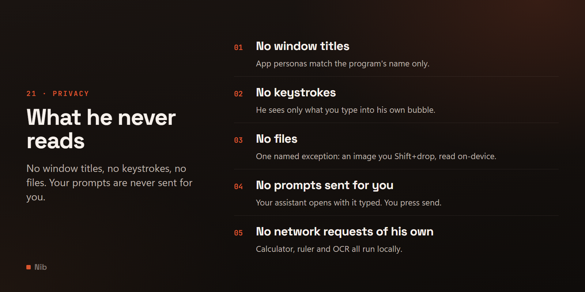

# Privacy

What he looks at, what he stores, and what he never touches.

[← back to the README](../README.md)

---

## Privacy

Worth being explicit, since he watches a few things in order to feel alive:

- **No Claude account data.** No usage, subscription, quota or history is read, scraped or shown.
  There is no supported API for it and none is attempted.
- **App reactions read the executable name only** — `claude.exe`, `chrome.exe`. Never window
  titles, which routinely contain document names, message subjects and URLs. Resolving a Store app
  through its `ApplicationFrameHost` window keeps to the same rule: that walk looks at the window
  *hierarchy* and at process IDs, and never at what any of those windows say.
- **World awareness costs nothing in privacy.** The time of day, the day of the week and the season
  come from your own clock. The load reaction is a single `GetSystemTimes` call — a system-wide
  busy/idle ratio, which says how hard the machine is working and nothing whatsoever about *what*
  is running. No process list, no window enumeration, no performance counters, no filesystem.
- **Nothing watches your files.** No Downloads folder, no file-system watcher, no recently-opened
  list. He has no idea what you have downloaded and no way to find out. The one exception is
  Drop-to-OCR, below - a file's actual bytes are only ever read when you explicitly hand him one.
- **Looking for something overhead, or for a window to stand on, reads rectangles only** —
  position and size, plus the window class name so the shell's own windows can be skipped. No
  titles, no contents, and nothing is recorded. Finding and following a window he's dropped onto
  works the same way; only what happens *after* he's found it is different — see below.
- **He never moves your windows, with one named exception.** Not nudged, not resized, no title
  ever read — except that dropping him on a window pins that one window on top, a single
  `SetWindowPos` call scoped to never move it, resize it, or steal its focus, and reverted the
  moment the perch ends. The test suite greps for every Win32 call that could touch a window and
  checks each function that looks at one is read-only, then separately checks the pin itself is
  the *only* place anything like it appears in the codebase, so the one exception cannot quietly
  widen into more than it says it is.
- **The screen guard's fog is never stored.** Each monitor is grabbed, shrunk straight away to at
  most 48 pixels wide — far too small to hold readable text — and the full-size grab is discarded
  on the spot. Nothing is written to disk or logged, and in a blackout no grabs happen at all. The
  guard's own windows are excluded from screen capture.
- **The guard's intrusion log lives in memory only.** Wrong PINs, blocked keys and a window
  stealing focus are noted with a time and a key or program name, shown to you once on unlock, and
  forgotten when you close that card. The keyboard hook only checks which shortcut keys are held to
  decide whether to swallow them; nothing you type is recorded.
- **The guard PIN is stored only as a scrypt hash** (`guard_pin_hash`, salted, n=2^14), never the
  PIN itself. Windows Hello stores nothing in Nib at all — Windows does the checking and answers
  yes or no.
- **The away timer uses the system idle clock**, which reports how long ago the last input happened
  and nothing whatsoever about what it was. It is not input monitoring.
- **The clipboard is read only at the moment the bubble opens**, to offer the paste chip. Nothing
  polls it and nothing stores it.
- **Prompts go only to the assistant you chose**, by handing a URL to the Windows shell — either a
  documented `claude://` link to the desktop app, or an ordinary `https://` link that your browser
  opens. Nib makes **no network requests of its own** — with one named exception, Update and
  restart, below, and only when you pick it — has no API key, and never talks to any of
  these services directly. The seasonal reactions come from your calendar, not from a weather
  service — deliberately, so this line stays true. See [Providers](PROVIDERS.md).
- **Your prompt history is stored, locally, and you can turn it off.** Up in the bubble walks back
  through the last `prompt_history_max` prompts (20 by default). They live in the same
  `config.json` as everything else, in plain text — the same place `last_prompt` has always been,
  just more of it. Set `prompt_history_max` to `0` to disable it and clear what is already there,
  or use **Clear prompt history** in the settings window.
- **Reacting to what you asked reads only the text you typed into his own bubble**, matches it
  against a short keyword table in `behavior.py`, and keeps nothing. It is not logged: the prompt
  body never reaches the log file at any level, including `DEBUG`.
- **The calculator parses what you type locally and never calls out.** Recognising a sum or a unit
  conversion in the bubble happens entirely inside `calculator.py`, with no network request of any
  kind — which is also why currency conversion is left out: every other conversion here is a fixed,
  physical-constant ratio, safe to bundle forever, while an exchange rate is either a live lookup or
  a table that goes stale, and Nib makes no network requests of its own (bar fetching its own
  update when you ask, below). The answer only reaches the
  clipboard if you click the toast to put it there, and nothing about a calculation — the expression
  or the answer — is logged, at any level, including `DEBUG`, the same rule as above.
- **The pixel ruler never looks at what's on screen.** It reads cursor position and monitor
  geometry/DPI — the same rectangles-only APIs used elsewhere for finding a window to stand on —
  and draws its own line and reading on top. It never takes a screenshot and never reads a single
  pixel of what's underneath. The reading only reaches the clipboard if you click it to put it
  there, and nothing about a measurement is logged, at any level.
- **Drop-to-OCR is the one feature that reads a file's actual bytes — and only the one file you
  Shift-drop on him, only when you do it.** Reading its text uses `Windows.Media.Ocr` first; if
  that's unavailable it falls back to a copy of Tesseract that ships inside Nib itself
  (`vendor/tesseract/`, Apache-2.0). Both run entirely on the device: no image, and no extracted
  text, is ever sent anywhere, and the fallback needs no separate install or download either. It's
  the same reasoning behind excluding currency conversion above — every claim on this page has to
  stay true forever, and a feature that phoned out (for the OCR itself, or to fetch the fallback
  engine) would make this one false. The text only reaches your assistant if you press Enter on
  the bubble it prefilled, the same as any other prompt, and nothing about a read — the image, the
  extracted text, or which of the two engines handled it — is logged, at any level, including
  `DEBUG`.
- **Update and restart is the one feature that makes a network request of its own — and only
  when you pick it from the wheel.** Nothing checks for updates by itself: not at start-up, not on
  a timer, not in the background. From a git checkout it runs `git fetch origin` and a fast-forward
  against the repository you cloned — and, only if the update changed `requirements.txt`,
  `pip install -r requirements.txt`, which downloads the changed packages from PyPI (the Python
  Package Index, or whichever index your pip is set up to use) and sends pip's own user agent,
  which names your Python version, Windows version and CPU type, the same as any pip install you
  run yourself. Nothing else. From the release build it asks
  `api.github.com` for this repository's latest release and, only if that is newer than the one
  you have, downloads its zip from GitHub. That request carries a generic `Nib-updater` user agent
  and nothing about you, your machine or your settings — no ID, no analytics, no "this version is
  running" ping; GitHub sees it the way it sees any download, which is your IP address. Your
  settings live in `%APPDATA%\NibMascot`, which an update never touches, and `update.log` there
  records only what the file swap did.
- **The mic and camera indicator reads state, never content.** Whether the default microphone is
  muted comes from `IAudioEndpointVolume`; whether anything is using the mic or camera comes from
  the `CapabilityAccessManager` consent store, the same place the Windows privacy indicator reads.
  **No audio is ever captured and no video is ever captured** — there is no code here that could,
  and the one microphone API involved reports and sets a mute flag and nothing else. The consent
  store does name the executables that used a device; those names are used only to answer "is any
  of them live right now?" and are then discarded, never stored and never logged — the same
  treatment the foreground-app reaction already gets. Muting your microphone is the only thing this
  feature ever *changes*, and it happens only when you ask for it — the tray entry, the shortcut,
  or the toast — never on a timer and never as a side effect of anything he does on his own.
- **Everything he remembers stays on your machine.** Settings, position, costume, your prompts,
  how the day has gone and how rested, fond and bored he is (three numbers and when they were
  written) live in `%APPDATA%\NibMascot\config.json`. What he remembers *about you
  two* lives next to it in `memory.json`: the day you first ran him, the date he last saw you, how
  many days he has seen you, lifetime counts of pets, prompts, completed focus sessions, treats,
  throws and hard landings, the same counts for the eight most recent days he has counts for
  plus how many minutes the machine was busy and how many you were present on each, and — if
  `memory_routine_enabled` is on — a 24-slot tally of which hour you first turned up each day.
  Plus a format version number. **That is the whole file.** No app names, no times of anything, no text.
  You can read it in **Settings → About him**, switch it off with `memory_enabled` (nothing is
  counted and no file is written, and one already there is left as it was), and **Forget
  everything** on that tab deletes it. The lines he occasionally says come from a local table in
  `assets/nib_phrases.json` (add your own in a `nib_phrases.json` next to `config.json`);
  nothing is generated by a model or fetched. The words he says are never written down, at any
  level, including `DEBUG`: the log notes only which kind of line it was (a greeting, a
  milestone), and the count of lines said today lives in memory only.
