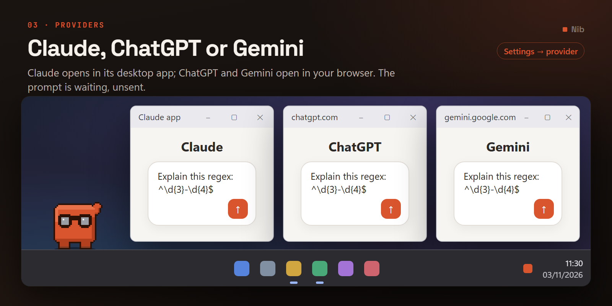

# Providers

Which assistant he opens, how each one works, and how to add another.

[← back to the README](../README.md)

---

## The three he ships with



| | `provider` | Opens | Modes | Prompt cap |
| --- | --- | --- | --- | --- |
| **Claude** | `claude` | The Claude desktop app | Chat, Cowork | 14,000 |
| **ChatGPT** | `chatgpt` | `chatgpt.com` in your browser | Chat | 6,000 |
| **Gemini** | `gemini` | `gemini.google.com` in your browser | Chat | 6,000 |

Change it in **tray → Settings… → Shortcuts → Provider**. It applies immediately; no restart.

---

## How it actually works

Every provider is the same operation: build a URL with your prompt in a query parameter, and hand
it to the Windows shell. What the shell does next is the only thing that differs.

**Claude uses a custom URL scheme.** `claude://claude.ai/new?q=...` — Windows knows that scheme
belongs to the Claude desktop app, routes the link to it, and starts it if it isn't already
running. Anthropic documents this.

**ChatGPT and Gemini use ordinary web links.** `https://chatgpt.com/?q=...` opens in your default
browser with the composer prefilled. It's the same URL shape browsers use when ChatGPT is added as
a search engine, which is why it's dependable.

That difference has one consequence worth knowing: **an `https://` link goes to your browser, not
to a desktop app**, even if you have the ChatGPT desktop app installed. Windows routes by scheme,
and `https` belongs to the browser.

### Why the caps differ

Claude's link goes to a local application and can carry 14,000 characters. The others travel as
browser URLs, and browsers start truncating well below that — 6,000 is a conservative number that
works everywhere. The bubble enforces whichever cap applies to your current provider, so a long
prompt is trimmed before it's sent rather than silently losing its end somewhere in transit.

### What's the same everywhere

- **The prompt is prefilled, not sent.** You review it and press send yourself. That's intended for
  every provider, not a limitation of one.
- **No network requests of Nib's own.** Handing a URL to the shell is not a request. He never
  talks to any of these services directly, has no API key, and reads no account or usage data.
- **The prompt is never logged.** Only its length. See [Privacy](PRIVACY.md).

---

## Modes

Claude has two — Chat and Cowork — so the bubble shows a picker. The others have one, so **the
picker is hidden entirely** rather than shown with a single button you can't unpick.

If you switch from Claude to ChatGPT while `cowork` was your remembered default, the bubble falls
back to that provider's first mode instead of opening with nothing selected.

---

## Adding another

One entry in `PROVIDERS` in [`launcher.py`](../launcher.py). Nothing else in the app knows which
assistant it's talking to.

```python
"myassistant": Provider(
    key="myassistant",
    label="My Assistant",
    modes={"chat": "https://example.com/chat"},
    query="q",                    # the parameter your prompt goes in
    max_chars=6000,
    download="https://example.com/",
    note="One line for the settings window.",
    mode_labels={"chat": "Chat"},
),
```

Then add the key to `_VALID_PROVIDERS` in [`config.py`](../config.py) so a hand-edited config can't
store a provider that doesn't exist, and add a row to the table above.

**Check it before committing:**

```python
python -c "import launcher; print(launcher.build_url('chat', 'hello world', 'myassistant'))"
```

### What to look for in a candidate

The only real requirement is **a URL that prefills the composer**. Most assistants support one,
because it's what browser search-engine integration needs — try adding the service as a custom
search engine in Chrome and see what URL it wants. If it takes `%s` in a query parameter, that
parameter is your `query`.

If a service has a documented custom scheme, prefer it: a desktop app avoids the browser's URL
length limit and doesn't open a new tab each time.

---

## About the colour

He ships Claude-orange by default — a nod to where this project started, even though he's fully
assistant-agnostic now. **Colour** in the tray has four other palettes — `ocean`, `forest`, `grape`
and `charcoal` — if you'd rather he didn't match a logo he isn't launching.

Claude, ChatGPT and Gemini are trademarks of their respective owners. This project isn't affiliated
with, endorsed by, or supported by any of them.
