# Using him

The launcher half: asking things, dropping things, and getting him out of the way.

[← back to the README](../README.md)

---

## What he does for you

| Action | Result |
| --- | --- |
| **Click him** | Opens the ask bubble above his head |
| **Ctrl+Alt+C** (anywhere) | Opens the bubble at your pointer — no hunting for him |
| **Ctrl+Alt+G** (anywhere) | [Guards the screen](#the-screen-guard): fog over every monitor until you unlock — background work keeps running |
| **Ctrl+Alt+P** (anywhere) | Puts the clipboard up on a sign he holds — grab more to add to it, click him to use it |
| Type + **Enter** | Launches Claude with the prompt prefilled |
| Type a sum or conversion + **Enter** | Answered inline with a toast next to him — nothing is sent |
| **↑ / ↓** in the bubble | Walks back through your recent prompts |
| **Shift+Enter** | Newline inside the prompt |
| **Esc** / click away | Dismisses the bubble (and counts as a poke) |
| **Double-click him** | Sends your `quick_prompt`, or repeats your last prompt |
| **Right-click him** | His [tool wheel](#the-tool-wheel) fans out around him — flick toward a tool and let go |
| **Shift+right-click him** | The full menu instead: ask, send-again, Chat/Cowork, hide for 10 minutes, then the whole [tray menu](#tray-menu) |
| **Drop a file on him** | Opens Claude asking about that file — no typing at all |
| **Shift+drop an image on him** | Reads its text locally and opens the bubble prefilled with it |
| **Drop selected text on him** | Opens the bubble with the text prefilled |
| **Come here** (tray) | He walks over to your pointer |
| **Start focus** (tray) | He plants himself and holds the working pose for a set length, then celebrates |
| **Measure** (tray) | Drag anywhere on screen for a live px/in/cm readout — click it to copy |
| **Mute microphone** (tray) | Mutes or unmutes your default mic; bind `mic_toggle_hotkey` to do it from anywhere |
| **Rest your pointer on him** | He leans into it — see [Petting him](BEHAVIOUR.md#petting-him) |
| **Scroll the wheel over him** | He spins. No reason at all |
| **Drag him** | Pick him up; he scowls and squirms, then tumbles back down to the taskbar |
| **Drop him on a window** | He stands on it and rides along as you move or resize it — grab him again to end it |
| **Flick him** | He flies, bounces off the ends of the strip, and rolls to a stop |
| **Drop him from a height** | He lands on his head — upside down, bandaged, dazed, seeing stars — for a few seconds |

### The first time you run him

He gives you a short tour — four tips, one at a time, over about half a minute — covering the
things that are genuinely undiscoverable: the click, the double-click, dropping a file on him, and
the global shortcut. It runs **once**, latched on `intro_seen`.

That last one is the reason the tour exists at all. The hotkey opens the bubble at your pointer
without going anywhere near him, so nothing on screen ever suggests it is there — and it is the
fastest way to use the whole app. **Show tips** in the tray menu replays the tour whenever you like.

### The ask bubble

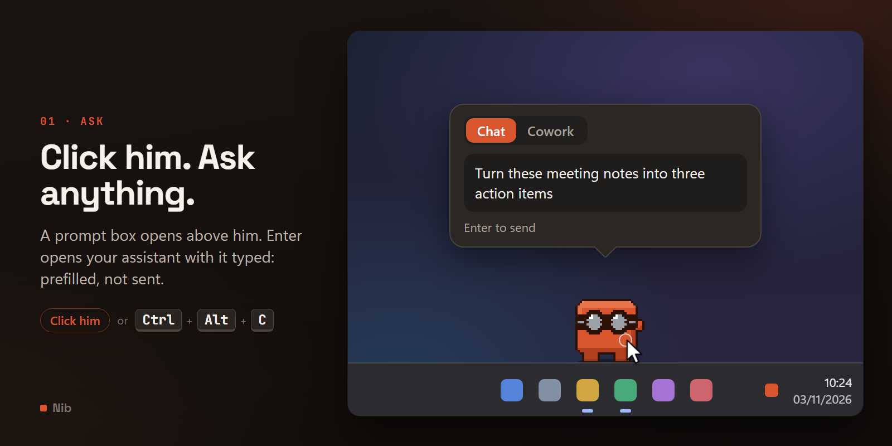

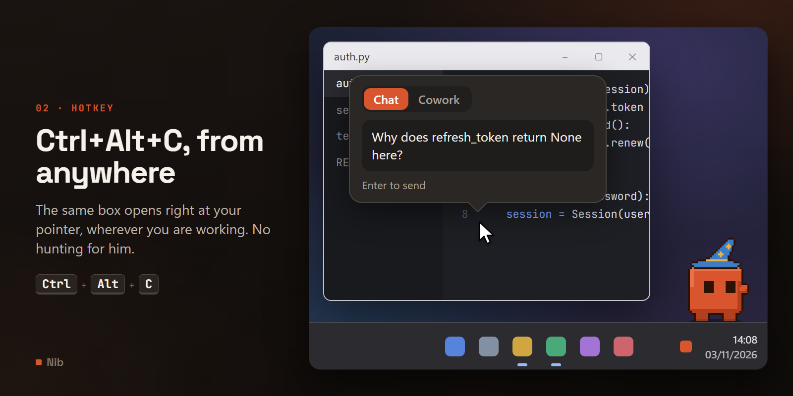

A **Chat / Cowork** toggle, a text field that grows to four lines and then scrolls, and a
**Paste clipboard** chip that appears only when your clipboard actually has text. Your last mode
choice is remembered. An empty send does nothing and keeps the bubble open.

The mode picker shows whatever the selected assistant offers — Claude has Chat and Cowork, the
others have one mode and so get no picker at all. See [Providers](PROVIDERS.md).

The prompt is **prefilled, not sent** — you review it and press send inside the assistant. That is
expected behaviour for every provider, not a limitation of one. Prompts are capped at the selected
provider's own limit: 14,000 characters for Claude, 6,000 for the ones that travel as browser
URLs.

### The tool wheel

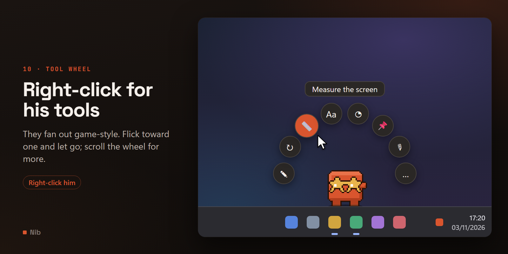

Right-click him and his tools fan out in an arc around him, the way a game character's weapon wheel
does: **Ask**, **Send again**, **Measure**, **Read text from an image**, **Focus**, **Pin the
clipboard**, **Mute microphone**, and **More…**.

Two ways to use it:

- **Hold and flick.** Press the right button on him, move toward a tool, let go. Aiming is by
  *direction*, not by landing on the icon, so a flick is enough. Let go back over him to cancel.
- **Click, then click.** A quick right-click leaves the wheel open; click a tool to pick it.
  Clicking anywhere else, **Esc**, or right-clicking again puts it away.

**He watches you choose.** While the wheel is open his eyes follow whichever tool you're aiming at,
by mouse or arrow keys, and he still blinks in between. Putting it away without choosing — **Esc**,
a click elsewhere, letting go back over him — gets a head scratch, and it's still not a poke.

The keyboard works too: **1**–**8** pick a tool by position, and the arrow keys plus **Enter** walk
round it.

**Scroll for more.** The arc shows eight tools at a time, and there are more on the ring than
that. Each notch of the mouse wheel steps it round by exactly one tool — the tools slide along
their slots, one leaving at one end as the next arrives at the other — and it wraps, so there's
no end to scroll back from. Scroll down (or right) for the next tools, up (or left) to go back;
**PageDown**/**PageUp** or **]**/**[** do the same from the keyboard. A trackpad's small deltas
add up to a notch before it steps, so one swipe is one step. Little arrowheads beyond the ends of
the arc mean there's more round the ring, and with nothing pointed at, the label says which part
you're in.

Scrolling turns the ring under the pointer rather than moving the pointer, so whatever slot you're
aiming at simply becomes the next tool along — and it works mid-gesture: hold the right button,
scroll to the tool, flick, let go. **1**–**8** always mean the eight tools showing right now.

The ring, in order:

| Group | Tools |
| --- | --- |
| **Tools** | Ask · Send again · Measure · Read text from an image · Focus · Pin the clipboard · Mute microphone · More… |
| **Him** | Do something · Surprise costume · Wardrobe… · Hide for 10 minutes · Guard the screen · Wander on/off · Pause/Resume · Ghost mode |
| **App** | Switch Chat/Cowork · Settings · Show tips · Send him home |

It always opens at the start, with every tool from the first group on the arc. That's deliberate:
the hold-and-flick is muscle memory, and muscle memory needs the same tool in the same direction
every time — a wheel that reopened wherever you left it would put Ask somewhere new each time.

Ghost mode can only be switched **on** from here: once it's on he's click-through, so nobody can
be right-clicking him — switch it off from the tray, which the wheel's label says. **Quit** is
deliberately not on the ring, because one stray flick should never close the app; it's in
**More…** and the tray.

Each tool is labelled with what it will do *right now* — **Stop focus** during a session, with a
ring round it; **Unmute microphone** while muted, with the same red or amber ring as the tray dot.
Tools that can't do anything are left off rather than greyed out: **Send again** only appears once
you've sent something, and the mic only when you have one. A wheel is aimed by direction, and a
direction that does nothing is worse than a shorter arc.

**Nearly every pick gets a reaction.** The tools that give him nothing to do get a short beat of
their own:

| Tool | His beat |
| --- | --- |
| Wander on/off | a hop |
| Ghost mode | a wink |
| Measure · Send him home | a look around |
| Mute/Unmute microphone | a foot tap |
| Switch Chat/Cowork | a sparkle |
| Settings | a bit of typing |
| Show tips | a wave |
| Resume | a stretch |

Pausing gets nothing, because it freezes him on the spot, and neither does **Stop focus**: a session
you end early earns nothing, by design. Ask, Send again, Read, starting a focus session, Pin the
clipboard, Do something and Surprise costume already have reactions of their own — though a Read
whose file picker you cancel leaves him as he was; Hide and Guard
take him off screen, and More… and Wardrobe… open something else. Right-click him while he's asleep and the wheel still
opens — nothing on it needs him awake — but he grumbles the way a click would, and won't react to
picks until he's up. Standing on a window he isn't held by the wheel, so he doesn't watch it or
react to picks there either.

**He lives on the taskbar, so the wheel opens toward the middle of the screen** — straight up with
him mid-taskbar, tilted inward at either end, downward on a top taskbar — and in a corner it widens
into a broader arc rather than pushing tools off the edge or crowding them together.

**More…** opens the full menu — costumes, colour, personality, settings, quit, and the extras that
only live there, like the Chat/Cowork picker and **Hide for 10 minutes** — so nothing is out of
reach. **Shift+right-click** goes straight to that menu, and `tool_wheel_enabled` set to `false`
makes it the right-click again, exactly as before.

### The wardrobe

**Wardrobe…** in the wheel's Him group opens the wheel again, with his costumes on it instead of
tools — each one as its own picture, cropped from the costume sheet. The ones you put on him last
come first, then **Take it off** while he's wearing something, then the rest by category: hats,
head pieces, eyewear, neckwear, body, and things on his back. The one he's wearing has a ring
round it.

It works like the wheel: scroll, flick or click, **1**–**8** for the ones showing, **Esc** or a
click elsewhere to put it away. With nothing pointed at, the label says roughly where on the ring
you are. He holds still and watches while it's open.

Pick one and he does a [quick-change](ART.md#costumes-and-colours): he crouches, hops, the outfit
swaps at the top of the hop, and he lands and gives his opinion. Your choice is saved straight
away, so it sticks even if something interrupts him.

### The calculator

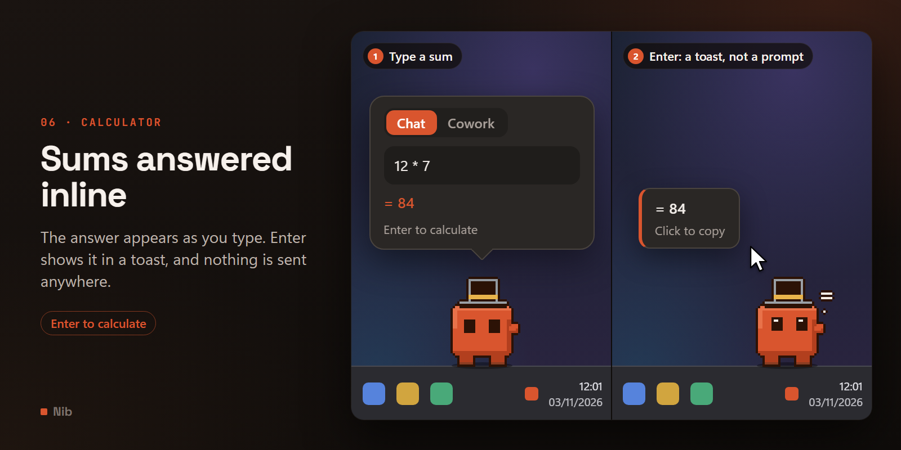

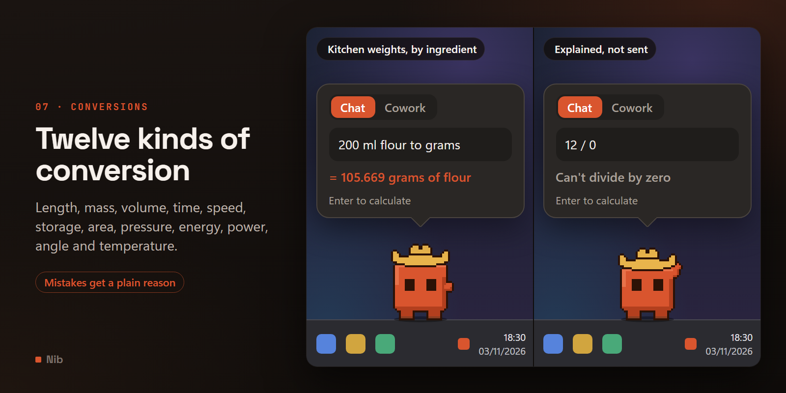

Type an arithmetic expression — `12 * 7`, `(1+2)*3`, `sqrt(16)`, `2 * pi` — or a unit conversion —
`3 miles in km`, `98.6 f to c`, `10 kg to lb`, `200 ml flour to grams` — into the bubble instead of
a question, and he answers it himself.

**You see it before you press anything.** The moment what you've typed is a recognised calculation,
a small answer line appears under the box in his accent colour, and the hint text switches from
"Enter to send" to "Enter to calculate" — a live preview, purely visual, and nothing is sent while
you type. Press **Enter** on it and the bubble closes the way it always does, but nothing launches:
instead a toast appears next to him with the answer. Click the toast and just the number is copied
to the clipboard. He also plays a short "counting" animation — borrowed as-is from the reaction he
already has to Calculator itself having focus — so answering a sum cost no new art.

Get one wrong on purpose and he still tells you, rather than asking your assistant about it:
`12 / 0`, `sqrt(-1)`, or `3 miles in kg` come back with a plain-English reason ("Can't divide by
zero", "Can't convert length to weight") inline in the bubble. There's no counting animation for
these and no copy chip — nothing about a wrong answer is worth celebrating or keeping. Anything
that only resembles a calculation — "why is the sky blue", "call John in 5 min", a bare "42" on its
own — is left completely alone and goes to your assistant exactly as before; the conversion grammar
only engages when both sides of it name a real, known unit.

It covers twelve dimensions — length, mass, volume, time, speed, digital storage (decimal `kb`/
`mb`/`gb`/`tb` and binary `kib`/`mib`/`gib`/`tib` are kept genuinely separate, not treated as the
same thing), area, pressure, energy, power, angle, and temperature — with every ratio bundled
directly in the code.

**Volume and mass convert too, but only when you say what's being measured.** `200 ml` of flour and
`200 ml` of honey are not the same weight, so `200 ml flour to grams` or `1 cup sugar in g` works —
a small kitchen density table covers water, milk, honey, oils, flour, both sugars, butter, cocoa
powder, rice and salt — while a bare `200 ml to grams` with nothing named stays quiet and goes to
the assistant, the same as an unrecognised unit does. Guessing water for everything would get most
of that table wrong.

Currency conversion is left out on purpose, for the same reason: "3 dollars in euros" is sent like
any other prompt. Every other conversion here is a fixed, physical-constant ratio, true forever and
safe to bundle; an exchange rate isn't — it's either a live network call, and Nib makes none of its
own, or a bundled table that goes stale. It may become its own, clearly opt-in feature later; it
isn't promised.

Nothing about a calculation counts as a prompt: it doesn't join your prompt history, doesn't
become `last_prompt`, doesn't move his mood, and doesn't clear pokes or count as one — though it
does still reset the being-ignored clock, the same as everything else you do with him. And nothing
about it is ever logged, at any level — see [Privacy](PRIVACY.md#privacy). Set `calculator_enabled`
to `false` to turn off both the preview and the interception; with it off, a sum you type is just
sent as text, the same as before this existed.

### The pixel ruler

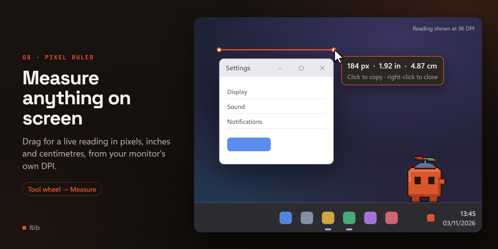

Pick **Measure** from his tool wheel, or from the tray icon's menu. A full-screen overlay appears over
whichever monitor your cursor was on; drag anywhere and a line follows you with a live reading in
pixels, inches and centimetres, converted using that monitor's own reported DPI. Release to lock
the reading in place.

**It never takes keyboard focus**, so whatever you're measuring — a dropdown, a tooltip, a panel
you opened just to check its size — stays exactly as it was underneath the overlay. The tradeoff is
that Escape and Enter don't do anything here, since a window that never takes focus never receives
key events either. Everything is mouse-only instead: once a reading is frozen, **any plain click**
— not specifically on the reading itself, anywhere on screen — copies it to the clipboard and
closes; **right-click**, at any point, mid-drag or already frozen, closes without copying anything.
Only a click-and-**drag** from a frozen reading starts measuring again in its place; measuring
several things in a row still doesn't need the menu reopened each time.

It doesn't dim the screen the way a screenshot tool does. The whole point is measuring something
you can already see; darkening it first would work against that.

### Your mic and camera

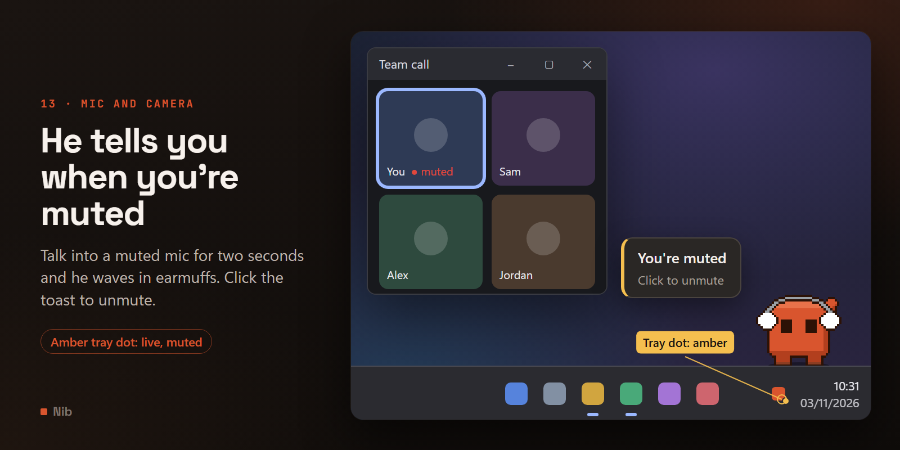

A dot on his tray icon whenever something is listening or watching: **red** while you are being
heard or seen, **amber** for the one state worth its own colour — the microphone is live, and
muted. The tray tooltip spells out which it is, and the dot sits in the opposite corner from the
pinned-window marker so both can be true at once and still read.

**Talk into a muted microphone** for `talking_while_muted_after_s` (2 seconds by default) and he
waves, wearing earmuffs, with a **You're muted** toast beside him — click it to unmute. He then
holds his tongue for a minute, because a mascot that says it every few seconds through a meeting
you muted deliberately is one you turn off within the hour. The delay exists because a microphone
goes live a moment before you actually start speaking, so a tell with no dwell would fire every
time anything so much as touched it.

The toast goes up whether or not he is in a state to perform the wave — asleep, in your hand, or
hidden, the message is the point and he is the decoration.

**Mute and unmute** from the tray entry, from the toast, or from `mic_toggle_hotkey`, which is
empty by default so it cannot collide with the push-to-talk or mute key your call app has already
claimed. It changes nothing else about your audio: not the level, not the device, not which app is
using it.

**The camera has no toggle, and that is Windows rather than a decision here.** There is no global
camera mute to call: per-app consent does nothing to an app that is already running, and disabling
the device outright needs admin rights and breaks the camera for every other app. So the camera
gets an honest in-use light and nothing more, and a test asserts the code offers no way to pretend
otherwise.

Nothing here records anything — see [Privacy](PRIVACY.md#privacy). It reads whether the mic is
muted and whether anything is using either device; no audio, no video, and not even which app
(the consent store names them, and that name is used only to answer "any of them?" before being
discarded). `mic_indicator_enabled` and `camera_indicator_enabled` turn either half off; with both
off nothing is read at all.

### The snippet billboard

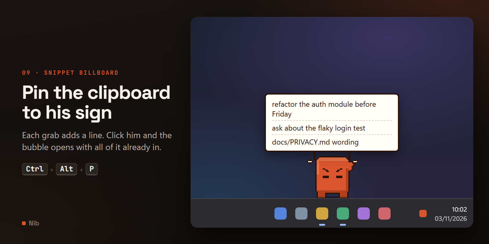

**Ctrl+Alt+P** grabs whatever is on the clipboard right now and puts it up on a small sign he
stands and holds — readable on your taskbar for as long as you want it there. He braces to hold
it — legs planted, teeth gritted, the same animation as bracing under a window — rather than idling
beside it, and stays that way for as long as it's up, so it reads as an effort rather than a prop
he could wander off and leave behind.

Grab again later and it doesn't replace what's up there — it adds another line underneath, so you
can build up a short running list of things as you go. Whenever you next click him (or press
Ctrl+Alt+C), the bubble opens with everything on the sign already in it, and the sign comes down.

Nothing here ever touches the disk — quitting takes the sign down, the same as closing an app tab.
This is a different thing from the **Paste clipboard** chip above, which pastes into a bubble
that's already open; the billboard is for collecting things *before* you're ready to ask about
them. `""` for `pocket_hotkey` turns it off.

If the clipboard has no text, a toast says so and he has a look round for it. Nothing goes up.

**↑ walks back through what you've asked before**, the way a shell does — the last
`prompt_history_max` prompts, 20 by default, newest first. ↓ comes forward again, and stepping
past the newest puts back whatever you had half-typed before you started browsing, so it is safe
to go looking.

The binding is deliberately **conditional**: ↑ only recalls when the caret is already on the first
line, and ↓ only when it is on the last. Otherwise the arrows move the caret as usual. Stealing
them unconditionally would make the box unusable for editing exactly the long prompts most worth
recalling. Any ordinary keystroke abandons the browse, so the next ↑ starts from the newest again.

Re-sending something moves it to the front rather than storing it twice. Set `prompt_history_max`
to `0` to switch the whole thing off and clear what is already stored, or use **Clear prompt
history** in the settings window. It lives in the same local `config.json` as everything else —
see [Privacy](PRIVACY.md#privacy).

### The focus timer

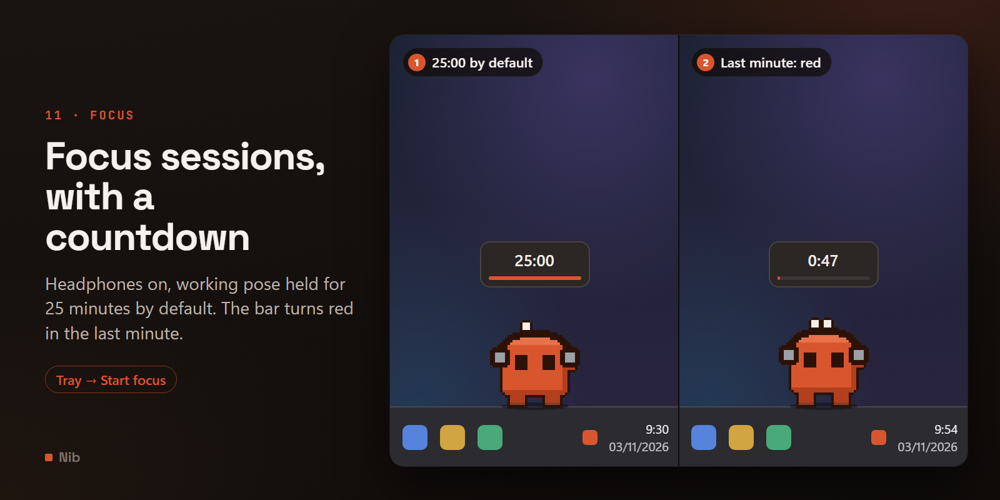

**Start focus** in the tray menu (or **Stop focus** once it is running) begins a Pomodoro-style
session, `focus_duration_min` long — 25 by default. He plants his feet, puts on a pair of
headphones — regardless of whatever costume you had picked, so the look means the same thing every
time — and holds the working pose, the same braced stance the snippet billboard uses. Every so
often that gives way to a burst of press-ups instead, existing art rather than a new animation, so
a 25-minute hold reads as sustained effort rather than one frame left running for the duration.

A small floating readout appears above him for as long as the session runs: a countdown and a thin
progress bar that turns from the usual accent colour to red in the last minute. That is on top of,
not instead of, the tray tooltip — the readout is for glancing at the desktop, the tooltip is for
when the tray is already where your eyes are.

He steps out of the pose to react to a poke, a costume change, or petting, same as anywhere else —
but the very next decision snaps him straight back into it, headphones and all, so the hold reads
as sustained rather than a one-off animation. Nothing else is blocked: click him, drop a file, keep
working around him exactly as normal.

Going idle at your `away_after_s` threshold pauses the countdown rather than burning it down while
you are not at the keyboard — a session left running over a coffee break holds where it left off.
Being made angry (four pokes in fifteen seconds by default) or called over with **Come here**
cancels it outright instead: both relocate or interrupt him in ways the hold cannot survive
honestly, so it ends there rather than pretending it is still running - and the readout comes down
the moment it does, whichever way it ended. Neither pays out the completion reward below — only
reaching zero on its own does.

Finishing a session on its own nudges his mood, plays its own completion chime if `sound_enabled`
— calmer than the CPU-driven cheer, deliberately, so the two never sound like the same event twice
— and, if he happens to be in a normal, awake state at that exact moment, plays the same
celebration as a finished task (see
[Behaviour](BEHAVIOUR.md#moments--things-he-does-once)). Nothing here touches the disk beyond the
one setting; there is no history of past sessions.

### Pinning him to a window

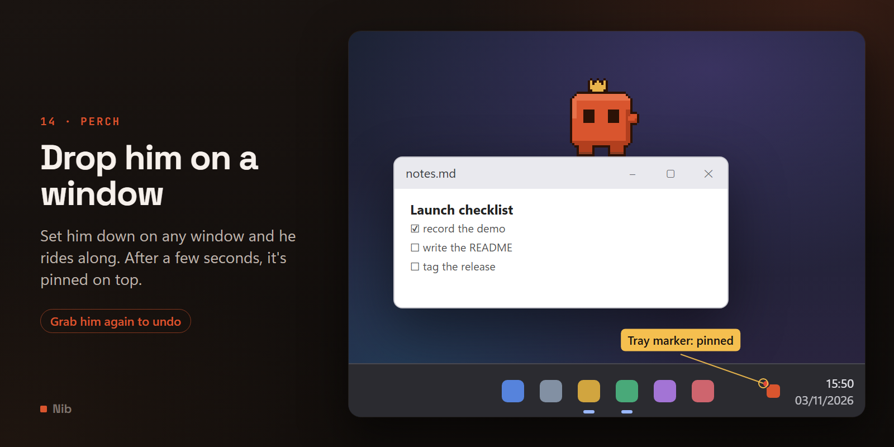

Set him down gently on any real window — a browser, an editor, a chat — and instead of tumbling
back down he stands on it, planted right on its top edge, and follows it if you move it, resize it,
or drag it to another spot, keeping the same relative place along its width rather than sliding
back to its centre every time. **A real flick still flies through the window like anywhere else** —
the same release speed that decides whether a throw arcs across the taskbar decides here whether he
sticks or sails past, so tossing him across the screen never surprises you by grabbing whatever
happens to be underneath.

Landing on it is not the same moment as pinning it. He has to stand there undisturbed for a few
seconds before the window actually gets pinned on top of everything else — long enough that it
reads as a deliberate perch rather than a drop that happened to land on a window in passing. Once
it does pin, the **tray icon picks up a small marker** and its tooltip says so, because a pinned
window can end up fullscreen and cover him completely — the tray is the one place left that still
shows it.

**This is the one deliberate exception to
[never touching your windows](BEHAVIOUR.md#he-never-moves-your-windows-with-one-named-exception).**
Finding the window under the drop point, and following it afterward, are both still read-only — the
same trick the overhead-window gag already uses. Pinning it is a single `SetWindowPos` call, scoped
as narrowly as Windows allows: it never
moves the window, never resizes it, never steals its focus, and it is the *only* place anything
like it exists anywhere in the codebase outside that one function — a test checks that directly
rather than trusting the docstring.

To take him down, grab him again — the same drag that put him there — and the pin comes off the
window immediately (or, if you grab him back before the dwell finished, nothing was ever pinned in
the first place). That is deliberately the only way off: there is no click, no hotkey, no menu
entry, because the gesture that puts him somewhere should be the same one that takes him back. If
the window closes, or gets minimized, while he's on it, he steps back down on his own rather than
being left standing on nothing - and there's nothing left to unpin at that point, since a closed
window doesn't keep any flags of its own.

A few things that also end it and unpin the window, because each one moves *him* some other way:
getting him properly cross, being called over with **Come here**, or quitting Nib outright while he
is still perched. None of these leave the window stuck on top with nothing left tracking it.

**One honest limit:** all of that cleanup runs from inside Nib. If the process is force-killed
rather than quit normally - Task Manager, a crash, `taskkill /F` - the pin does not get a chance to
come off, and the window stays on top until something else changes it (opening Nib again and
repeating the drag-off gesture works, since a fresh perch's own unpin logic doesn't care how the
last one ended). An ordinary quit, or ending the perch yourself, always cleans up first.

### He reacts to what you asked

If the app doesn't open there's no "on it": he does a double-take and the toast offers the
download page. When the launch goes through, and once the "on it" animation finishes, he has a
brief opinion about the *shape* of what you sent:

| What you asked | What he does |
| --- | --- |
| "thanks", "cheers", "appreciate it" | Heart eyes |
| Code — a fence, `def `, `import `, `SELECT ` | Types along with you |
| "fix", "bug", "error", "crash", "failing" | Braces himself and heaves |
| "email", "reply", "draft" | Sorts the post |
| "why", "how does", "explain" | Looks around, thinking |
| Anything over 420 characters | A double-take |

He already has the text — **you typed it into his own bubble** — so this costs nothing in privacy
and nothing in new art. It is a keyword table over animations that already exist. The text is
matched and discarded: it is never stored beyond the history above, and it is **never logged**, at
any level including `DEBUG`. Set `prompt_reactions` to `false` to switch it off.

### Dropping things on him

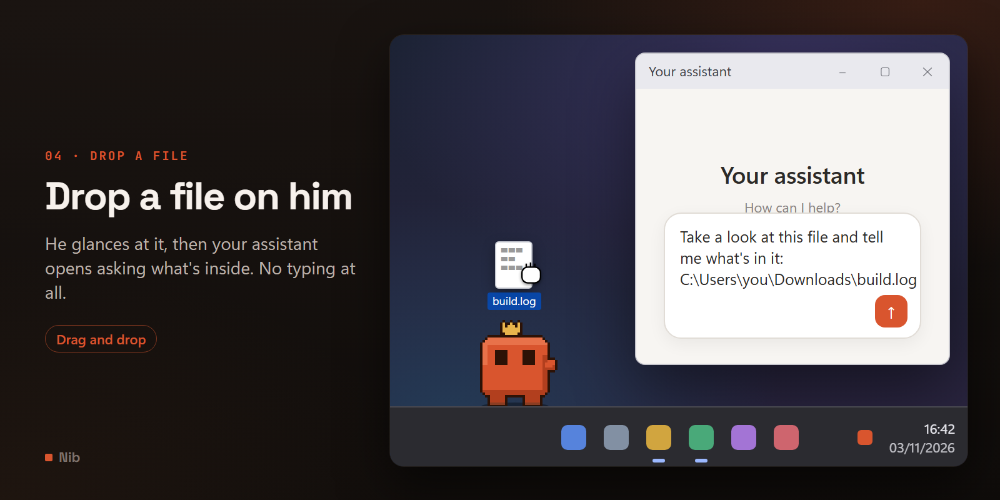

Dropping is the fastest way to use him.

- **Files** go straight through: "look at this file" is unambiguous, so there is nothing to ask.
  Paths are converted to native backslashes, since they end up inside a prompt.
- **Text** only prefills the bubble. He has the content but not the instruction, and guessing what
  you wanted done with it would be worse than asking.
- **Images, with Shift held**, read their text instead of being discussed as a file - see
  [Drop-to-OCR](#drop-to-ocr) below.

### Drop-to-OCR

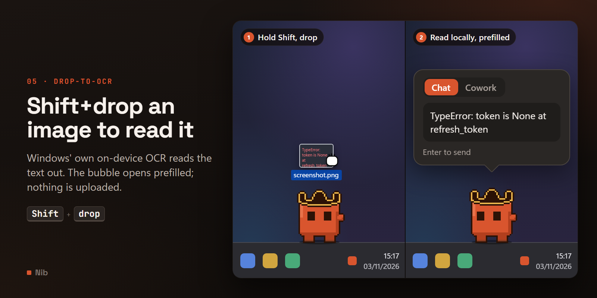

Hold **Shift** and drop a screenshot or a photo of text on him, instead of an ordinary drop, and
he reads the text out of it - locally, with Windows' own on-device OCR engine - and opens the
bubble prefilled with what he found, the same as dropping plain text does.

The modifier exists because an ordinary drop already means something: it opens your assistant to
discuss the file. Reading its text instead has to be something you ask for, not something that
silently takes over the moment a dropped file happens to be an image. Drop one without Shift and
none of this is involved - it's discussed as a file, exactly as before.

Nothing is sent anywhere to do the reading; `Windows.Media.Ocr` runs entirely on the device, the
same guarantee the calculator and the pixel ruler both make. If that engine is ever unavailable or
fails, a copy of Tesseract bundled inside Nib itself takes over automatically - still fully local,
nothing to install or download. He plays his "look_around" animation on a successful read, either
way - the same one used elsewhere for a *why*/*how*/*explain*-shaped prompt, not new art. An image
with no readable text in it, or both engines being unavailable, gets a plain message and no
animation. Nothing about a read is ever logged - see [Privacy](PRIVACY.md#privacy).

### Picking him up, throwing him, and dropping him

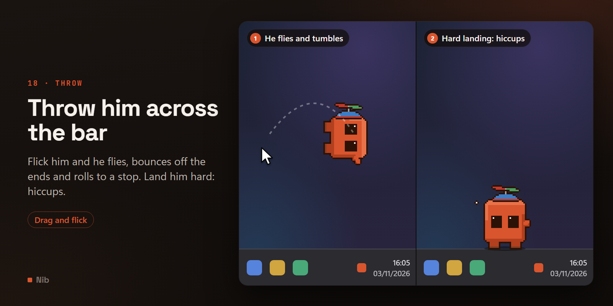

Drag him anywhere: he scowls and squirms in your grip. Let go and he **tumbles end over end** all
the way down, eyes wide. Drop him from higher than about 60px and he lands **on his head** — upside
down with his legs in the air, a bandage round his head, crossed eyes and stars going round — for
`injury_duration_s` (3s by default), then rights himself and carries on.

**Flick him and he flies.** The drag's velocity is carried into the fall, so he arcs across the
taskbar, **bounces off the ends** of the strip, and **rolls to a stop** along the ground. Measured
on a real throw: 1,360px of travel in 464ms.

Three details that make it feel right rather than random:

- **Drag him, hold still, let go, and he drops on the spot.** The launch velocity is averaged over
  the last ~140ms rather than taken from the final two positions. A two-sample delta is only zero
  if the very last sample happened to be stationary; a windowed average is reliably zero. That is
  the whole difference between a flick and "he flies every time you let go."
- **The tick runs at full rate while he is in your hand**, because those ticks *are* the velocity
  samples — at the normal 50ms movement rate a flick is only three of them to average.
- **The roll costs no new art.** He is already tumbling in mid-air, so continuing the same frames
  on the ground while friction bleeds off his speed reads as rolling.

Injury is **judged at the impact but shown once he stops**. Entering the dazed state the instant
he touched down froze him mid-skid — and since any throw from a real height hurts, the roll never
appeared at all. Now a hard throw skids to a halt and *then* he sits up seeing stars.

Hitting the **end of the strip** hard enough is its own way to get hurt, separate from the
fall-distance rule: he crumples against it rather than bouncing away. The fall threshold was tuned
against real drops, so rewriting it in terms of impact speed would have meant re-tuning something
already verified — the wall rule was added alongside it instead.

Both the spin and the upside-down landing are **baked into frames** rather than done as runtime
transforms. Quarter turns are exact permutations of the pixel grid, whereas an arbitrary rotation
angle would have to resample and would either blur the art or shred it into jaggies. Each rotated
or flipped frame is then re-seated on the baseline, so the sprite never floats or jumps as he
switches between spinning, landing and standing — and the costume anchors are mapped through the
same transform, so a hat still tracks his head even when his head is the part on the floor.

Shuffling him along the taskbar does not hurt him; the fall has to be a real one. And if you drop
him mid-nap he goes straight back to sleeping rather than being hurt — he was already down.

### Double-click and the last prompt

Every successful send is remembered as `last_prompt`. A double-click sends `quick_prompt` if you
have set one, otherwise it repeats that last prompt — a one-gesture "do that again". With neither
set, it just opens the bubble. The same repeat is available from his right-click menu.

### The screen guard

**Guard the screen** — on the wheel, in the tray menu, or **Ctrl+Alt+G** (`guard_hotkey`) — is for
stepping away while agents, builds or downloads keep working. Every monitor fills with a thick fog
of your own desktop (colours and movement only, never readable text), a pair of giant pixel eyes
follows the pointer, and he stands guard on a little stage underneath with a running commentary.
Nothing is paused: the guard is only windows on top, plus a small helper process that holds the
keyboard shortcuts and keeps the machine awake.

**Getting back in.** Windows Hello if this PC has it — the button opens the normal Hello prompt — or
your guard PIN. The PIN field is hidden: **click anywhere** on the guard (fog or blackout alike) and
it appears, then type the PIN and press Enter. Left untouched for 20 seconds it hides again. The
first time you guard on a PC without Hello, he asks you to choose a PIN (at least four characters,
typed twice); only a scrypt hash of it is stored. Once you are in you get a choice:

- **Peek N min** (`guard_peek_minutes`, 2 by default), the big button in the middle (Enter picks it),
  lifts the guard for a few minutes. A small chip in the corner counts down, with **+N min** and
  **Lock now**; when it runs out the guard comes back by itself.
- **unlock**, a faint little link in the top-right corner, ends the guard and brings him back. It is
  kept small on purpose so a passer-by only notices Peek. If anything happened while you were away, a card
  lists it ("14:02 – 3 wrong PINs"); it is kept in memory only and forgotten when you close it.

Pick neither and after a minute it goes back to fog, so an unlocked screen is never left with an
**Unlock** button on it for whoever walks past.

**What turns the screens black.** While guarded, the Windows key, Alt+Tab, Alt+Esc, Alt+F4 and
Ctrl+Esc are swallowed; pressing one, three wrong PINs (`guard_blackout_after_attempts`),
Ctrl+Alt+Del, or someone clicking another window to the front blacks out every monitor. Only red
eyes stay, and the PIN field. A window an agent opens on its own (no one at the keyboard) is
pushed back under the fog and only logged. Wrong PINs make you wait 1 s, 2 s, 4 s … up to 30 s
between tries. If some other window has the keyboard while the fog is up (say the guard came back
by itself after a peek), every key is quietly held back rather than typed into it — click the fog
and type your PIN.

**Win+L still locks Windows**, deliberately. Unlocking Windows ends the guard too
(`windows_unlock_clears_guard`; always, if you have no guard PIN), which is the way back in if
you forget the PIN or Hello stops working: Ctrl+Alt+Del → Lock → your Windows sign-in. To choose a new PIN, clear `guard_pin_hash` in `config.json`.

**If Nib crashes mid-guard**, the helper process covers every screen in plain black and holds the
keyboard until you unlock Windows; start Nib again and it picks the guard back up, blacked out.

Optional: `guard_auto_after_idle_min` guards by itself after that many idle minutes (off by default,
and only once a PIN or Hello is set up); `guard_lock_fallback` locks Windows after ten wrong PINs;
`guard_scene` picks eyes, Nib or both; `guard_background_fx` switches off the life in the fog (his
little worker bots, the dust, the camera scan line and **REC** clock, the time-of-day glow). Lines
he says come from `assets/guard_phrases.json`; a `guard_phrases.json` in the settings folder adds
your own. See the
[settings](SETTINGS.md#away-guard).

It is a strong deterrent for coworkers, kids and cats, not a vault: Ctrl+Alt+Del cannot be blocked
(it blacks the screens out instead), a touchpad gesture or a toast can show through for a moment
before the fog re-asserts itself, and turn on Do Not Disturb if notifications matter.

---

## Getting him out of the way

Three different answers, because they solve three different problems:

| | What it does | When you want it |
| --- | --- | --- |
| **Come here** | He walks over to your pointer | You can't find him — he roams every screen |
| **Ghost mode** | Faded to 35% and completely click-through | He is in the way, today |
| **Hide for 10 minutes** | Fades out, comes back on his own and waves | You need the space briefly |
| **Pause** | Freezes him where he stands | You want him still |

**Ghost mode is the important one.** On the day a mascot is in the way, the alternatives are
pausing him — he freezes mid-stride, which looks broken — or uninstalling him. This leaves him
there, doing everything he normally does, and totally inert: `WS_EX_TRANSPARENT` means Windows
skips his window when hit-testing, so every click, hover and drag lands on whatever is behind him,
including the contact shadow. It is one flag rather than an emptied click mask, and it covers every
pixel.

The **hotkey still works** in ghost mode, and that is deliberate: ghost mode is about him being out
of the way of your *mouse*, and a launcher you have switched off by accident is worse than a mascot
in the way. `ghost_opacity` is clamped to a floor of `0.08` — a mascot you can neither see nor click
is indistinguishable from a crashed one, and the tray would be your only way back.

**Come here** is on the tray menu (first, since that is where you look when you cannot find him) and
optionally on a second global shortcut via `come_hotkey`, which is empty by default so it cannot
collide with anything you already use. Being called counts as attention, so it also gets him up
from a nap and ends a sulk — he was put out because you were not paying attention, and you just
did. Only being in your hand refuses outright.

---

## Sound

Off by default. Eight short blips: opening the bubble, sending, a dismissed bubble, losing his
temper, landing after a drop, being petted, dropping off, waking up.

**No audio ships in this repository.** Exactly like the sprites, the WAVs are *synthesised in code*
from a handful of oscillators and envelopes — `tools/gen_sounds.py`, standard library only, about
72 KB of 22kHz mono for the whole set:

```bash
python tools/gen_sounds.py
```

Until you run that there is nothing to play, and that is a silent no-op rather than an error. So is
a machine with no audio device, a Qt build without the multimedia backend, and a missing individual
file. Nothing in the sound layer can raise into the tick — it is decoration on a mascot.

Square and triangle waves rather than sine, because a pure sine at this length reads as a system
beep; the pixel art is made of hard edges and so is this. The sweep direction does most of the
work: **send** is two notes up, **poke** is the same two notes down. Deliberately dull — a mascot
whose noises are interesting is a mascot you mute within the hour.

Fourteen of them. The involuntary four are each **two parts**, which is what makes them read as one
event happening *to* him rather than a beep: the sneeze is a rising breathy note then a burst of
noise (pitched, it sounds like a bird), the trip is a downward slip then a small thud, the hiccup is
short and pitched *up* because a hiccup is a catch rather than a note, and the spin is a whirr up
and back down. Two of them are deliberately celebratory, and deliberately different from each
other: **cheer**, for the CPU watcher's finished-task celebration, is a rising three-note major
arpeggio with a flourish on the end; **focus_done**, for a completed focus session, is calmer — two
soft notes a fifth apart, closer to a meditation timer's bell than a triumph — so the two
accomplishments never sound like the same event even when they land back to back. Everything else
here is quieter by design.

The same event will not retrigger inside 140ms, because he can bounce three times in half a second
and three thuds in half a second is a bug that sounds like a machine gun.

---

## Tray menu

Right-click the tray icon (a left click opens the same menu — it deliberately does **not** toggle
pause, which used to be an easy way to freeze him by accident). **Right-clicking him directly opens
the exact same menu** — Windows can tuck the tray icon into the overflow area, and he is usually
easier to find than it is — with a few things pinned above it that only make sense right on him:
asking, repeating your last prompt, the mode picker, and hiding him for 10 minutes. Those extras
are only ever shown that way; they close with the menu and never appear on the tray icon's own
copy of it.

- **Come here** — he walks over to your pointer. First on the menu, because this is the menu you
  open when you cannot find him
- **Do something** — plays one of his rarer animations now, rather than whenever it is due
- **Wander** — turn strolling on/off; he still does in-place antics and reacts to you
- **Pause / Resume** — freeze him where he stands
- **Ghost mode** — faded and click-through; see [above](#getting-him-out-of-the-way)
- **Costume** (with **Surprise me** at the top; he hops into whatever you pick) / **Colour** /
  **Personality** — as above
- **Settings…** — the whole settings file, as a form
- **Show tips** — replay the first-run tour
- **Launch on Windows startup** — adds/removes an `HKCU\...\Run` entry
- **Reset position** — send him back to his home spot
- **Measure** — drag anywhere on screen for a px/in/cm reading; see [The pixel ruler](#the-pixel-ruler)
- **Guard the screen** — fog over every monitor until you unlock; see [The screen guard](#the-screen-guard)
- **Mute / Unmute microphone** — reflects the live state, and is hidden entirely if you have no
  microphone; see [Your mic and camera](#your-mic-and-camera)
- **Quit**
